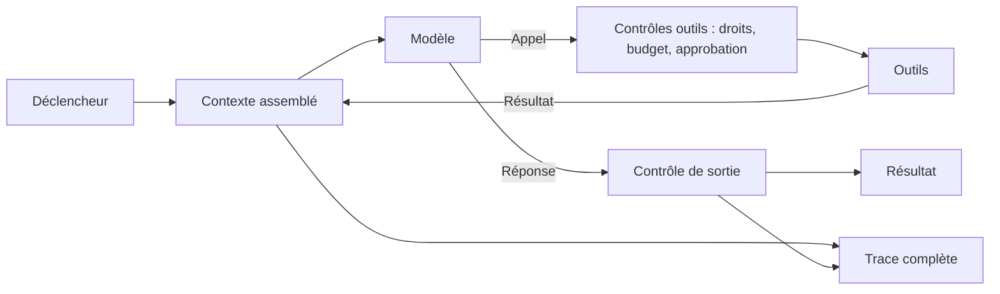

## En bref

Un agent est un modèle qui, dans une boucle, choisit des outils, lit leurs résultats et décide de la suite, jusqu'à atteindre un résultat ou une limite. Autour de ce noyau, sept composants déterminent son comportement en production. Le prompt n'est que l'un d'eux, et rarement le plus décisif : **la qualité se joue d'abord dans les outils et dans le contexte**, c'est-à-dire dans ce que l'agent peut faire et dans ce qu'il voit au moment de décider.

Pour un FDE, cette grille sert à deux choses : spécifier un agent sans oublier de composant, et localiser la cause d'un défaut au lieu de retoucher le prompt à l'aveugle.

## Quand l'utiliser

- En phase [Concevoir](/methode/concevoir), pour structurer la [fiche agent](/templates/fiche-agent) : chaque composant y a sa section.
- En revue de conception, pour vérifier que les garde-fous et l'observabilité sont spécifiés avant la construction, pas ajoutés après le premier incident.
- En diagnostic d'un agent qui déçoit : on attribue chaque erreur observée à un composant.

Ne pas l'utiliser pour décider s'il faut un agent : c'est l'objet de [l'échelle des solutions](/frameworks/faut-il-un-agent). Un workflow du barreau 3 n'a pas de boucle pilotée par le modèle.

## Comment l'appliquer

### 1. Spécifier les sept composants

| Composant | Question de conception | Défaut typique s'il est négligé |
| --- | --- | --- |
| **Modèle** | Quelle capacité minimale suffit, quelle version est figée ? | Dérive silencieuse après une mise à jour du fournisseur |
| **Instructions** | Quelle mission, quelles règles métier, quel format de sortie ? | Comportement correct sur la démo, incohérent sur les cas limites |
| **Outils** | Quelles actions, avec quels paramètres, quels droits ? | Mauvais outil choisi, paramètres inventés, actions hors périmètre |
| **Contexte et mémoire** | Que voit l'agent à chaque étape, que conserve-t-il ? | Information clé noyée ou absente, contexte saturé |
| **Boucle d'exécution** | Quand s'arrête-t-il, combien d'étapes, que faire en cas d'échec d'un outil ? | Boucles infinies, abandon prématuré, coûts imprévisibles |
| **Garde-fous** | Qu'est-ce qui est bloqué hors du modèle, par du code ? | Une instruction malveillante suffit à déclencher une action |
| **Observabilité** | Que trace-t-on, qui lit les traces ? | Impossible d'expliquer une erreur ni de rejouer un cas |

### 2. Distinguer ce qui relève du modèle et ce qui relève du code

Le modèle décide ; le code contraint. Les limites de budget, les droits d'accès, la validation de schéma et les approbations sont exécutés hors du modèle. Une règle qui n'existe que dans le prompt est une préférence, pas un garde-fou.

### 3. Investir dans l'ordre de rendement

Sur un agent qui se trompe, examiner dans cet ordre : les **résultats d'outils** (trop verbeux, ambigus, incomplets), le **contexte** (l'information était-elle présente et lisible ?), les **descriptions d'outils**, puis seulement les instructions. Changer de modèle vient en dernier.

### 4. Tracer la boucle complète

Chaque exécution produit une trace : entrée, contexte assemblé, appels d'outils avec paramètres et résultats, décision finale, coût et durée. Sans cette trace, l'évaluation de trajectoire et l'analyse d'incident sont impossibles.

## Exemple

L'Agent Diagnostic de SAV Augmenté, décomposé selon la grille.

| Composant | Choix retenu |
| --- | --- |
| Modèle | Version figée, golden set rejoué chaque nuit, retour arrière en une commande |
| Instructions | Arbre de diagnostic des 12 motifs récurrents, priorité absolue à l'incident collectif connu, sortie JSON validée par schéma |
| Outils | Cinq outils en lecture : `supervision.etat_service`, `ligne.lancer_test`, `inventaire.lire_parc`, `incidents.rechercher_connus`, `kb.rechercher` |
| Contexte et mémoire | Ticket qualifié transmis par l'Orchestrateur, articles validés depuis moins de 12 mois, mémoire limitée à la durée du cas |
| Boucle | 12 appels d'outils, 0,50 € et 5 minutes au maximum ; escalade après 8 appels sans conclusion |
| Garde-fous | Chaque cause doit citer un résultat d'outil, vérifié par code ; filtrage sur l'identifiant client du ticket |
| Observabilité | Trace complète conservée 13 mois, données personnelles masquées |

Pendant le prototype, les erreurs de diagnostic analysées une à une remontaient le plus souvent à des résultats d'outils difficiles à exploiter (listes d'alarmes brutes, codes non expliqués) plutôt qu'aux instructions. La reformulation des réponses de `supervision.etat_service` en synthèse structurée a davantage amélioré la justesse que les itérations sur le prompt.

## Pièges à éviter

- **Tout régler dans le prompt.** Parade : pour chaque règle critique, nommer le mécanisme de code qui l'applique.
- **Oublier la condition d'arrêt.** Un agent sans plafond d'étapes finit par boucler. Parade : budgets d'étapes, de coût et de durée dans la fiche agent, testés sur le jeu adverse.
- **Changer de modèle au premier défaut.** Parade : attribuer chaque erreur à un composant avant toute décision ; le modèle vient en dernier.
- **Ajouter l'observabilité après la mise en production.** Parade : exiger la trace complète dès le prototype ; elle alimente les évaluations.
- **Donner tous les outils à tous les agents.** Parade : un outil n'est accordé que s'il sert la mission écrite en une phrase.

## Pour aller plus loin

- Frameworks : [concevoir les outils d'un agent](/frameworks/conception-outils), [context engineering](/frameworks/context-engineering), [garde-fous](/frameworks/garde-fous), [évaluer un agent](/frameworks/evaluation-agents)
- Templates : [fiche agent](/templates/fiche-agent), [system prompt](/templates/system-prompt-agent)
- Guide : [concevoir un agent](/guides/concevoir-un-agent) ; outil [Agent Designer](/outils/agent-designer)
- Savoir terrain : [les outils avant les prompts](/savoir/outils-avant-prompts)
