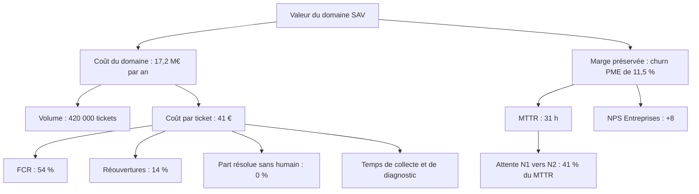

## En bref

Un arbre de valeur part d'un résultat financier (coût, revenu, marge, capital) et le décompose, niveau par niveau, jusqu'aux leviers opérationnels sur lesquels un agent agit. Chaque branche est une relation arithmétique ou causale explicite.

Pour un FDE, il remplit trois fonctions : chiffrer l'hypothèse de valeur dès le cadrage, montrer au directeur financier par quel chemin un agent produit des euros, et choisir les indicateurs à suivre. Sans arbre, on mesure ce qui est facile (nombre de conversations) au lieu de ce qui compte.

## Quand l'utiliser

- Au [cadrage](/methode/cadrer), pour formuler l'hypothèse de valeur.
- Au [diagnostic](/methode/diagnostiquer), pour mesurer la référence de chaque feuille.
- En [Cibler](/methode/cibler), pour rattacher chaque cas d'usage à une ou plusieurs feuilles.

Ne pas l'utiliser pour des bénéfices sans chemin financier plausible : les noter à part, comme bénéfices qualitatifs.

## Comment l'appliquer

1. **Partir du résultat que suit la direction.** Question : « Quel chiffre du compte de résultat ce domaine déplace-t-il ? » Résultat : la racine, avec sa valeur de référence.
2. **Décomposer de façon exhaustive et sans recouvrement.** Volume × coût unitaire, revenu × marge, taux × base. Vérifier que les branches d'un même niveau recomposent bien le parent.
3. **Descendre jusqu'aux leviers actionnables.** S'arrêter quand une feuille est un comportement ou un indicateur qu'un agent ou une équipe peut déplacer : taux de résolution au premier contact, délai, taux d'erreur.
4. **Qualifier chaque indicateur.** **Avancé** : bouge en jours ou semaines, pilote l'action (taux d'erreur de qualification, part des tickets en voie autonome, adoption). **Retardé** : bouge en mois, prouve la valeur (coût par ticket, NPS, churn).
5. **Rattacher les cas d'usage.** Chaque cas d'usage pointe vers les feuilles qu'il déplace et une estimation de l'effet. Un cas qui ne touche aucune feuille n'a pas de valeur démontrable.
6. **Mesurer la référence de chaque feuille** et la faire valider par la finance. Ces références alimentent le [registre de valeur](/frameworks/registre-de-valeur).

## Exemple

L'arbre du domaine Assistance & SAV Entreprises de Voxalis.

| Feuille | Type | Référence | Effet attendu |
| --- | --- | --- | --- |
| Erreur de qualification | Avancé | 9 % | Moins de tickets mal routés, donc moins d'attente N1 vers N2 |
| FCR | Avancé | 54 % | Moins d'escalades, coût par ticket en baisse |
| Réouvertures | Avancé | 14 %, soit environ 58 800 tickets retraités | Chaque réouverture évitée retire un traitement complet |
| Part résolue sans humain | Avancé | 0 % | Cible de 35 % en voie autonome |
| MTTR | Avancé pour le churn | 31 h | Cible de 12 h à 18 mois |
| Coût par ticket | Retardé | 41 € | Cible de 26 € |
| Churn PME | Retardé | 11,5 % | Cible de 10,0 %, soit 1,6 M€ de marge par an sur 240 M€ à 45 % de marge |

La branche coût porte le gain d'efficacité (6,3 M€ de potentiel, 3,8 M€ captés) ; la branche marge porte la rétention (1,6 M€). Le MTTR n'agit pas directement sur le coût : il agit sur la satisfaction et le churn, d'où son double statut.

## Pièges à éviter

- **Additionner des branches qui se recouvrent.** Compter le même temps gagné en coût et en capacité. Parade : vérifier que chaque niveau recompose son parent.
- **S'arrêter trop haut.** « Réduire le coût du SAV » ne se pilote pas. Parade : descendre jusqu'à un indicateur hebdomadaire.
- **Ne suivre que les retardés.** Le churn se lit à 12 mois, trop tard pour corriger. Parade : piloter les avancés, prouver avec les retardés.
- **Inventer des relations causales.** Parade : signaler les liens supposés et les tester en pilote.

## Pour aller plus loin

- Frameworks : [registre de valeur](/frameworks/registre-de-valeur), [business case et coût complet](/frameworks/business-case-tco), [mesurer l'impact réel](/frameworks/mesure-impact), [problème et hypothèses](/frameworks/probleme-hypotheses)
- Templates : [arbre d'hypothèses](/templates/arbre-hypotheses), [tableau de bord de valeur](/templates/tableau-de-bord-valeur)
- Guide : [chiffrer la valeur](/guides/chiffrer-la-valeur)
