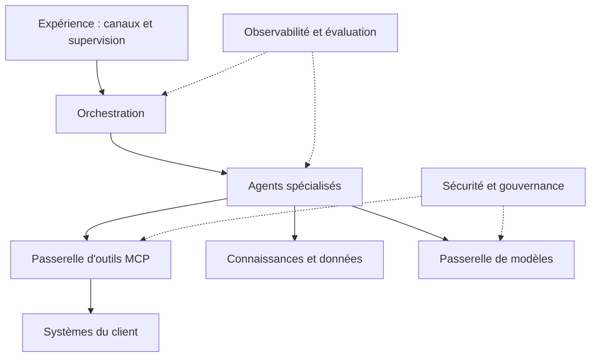

## En bref

Un agent en production n'est pas un prompt branché sur un modèle : c'est une pile de huit couches, chacune avec sa responsabilité et son propriétaire. L'architecture de référence sert de grille pour ne rien oublier et pour placer chaque décision au bon endroit. Trois principes la gouvernent : **découpler** (une couche change sans casser les autres), **réutiliser** (outils, connaissances et observabilité servent à tous les agents), **ne dépendre d'aucun modèle** (le modèle est un composant remplaçable derrière une passerelle).

Pour un FDE, c'est aussi la meilleure défense contre le prototype qui ne passe jamais à l'échelle : ce qui n'a pas sa couche au moment de la conception se retrouve codé en dur dans un prompt.

## Quand l'utiliser

- En phase [Concevoir](/methode/concevoir), pour structurer le [dossier d'architecture](/templates/dossier-architecture-multi-agents) et la revue avec la DSI.
- En phase [Industrialiser](/methode/industrialiser), pour identifier ce qui doit devenir commun avant le deuxième agent.
- En revue d'un prototype existant : chaque couche absente est une dette nommée.

Ne pas l'imposer en entier à un prototype de quatre semaines : on y stubbe les couches passerelle de modèles et gouvernance, mais on les nomme.

## Comment l'appliquer

### 1. Placer chaque composant dans sa couche

| Couche | Responsabilité | Question à poser |
| --- | --- | --- |
| Expérience | Canaux client, poste de supervision des humains | Où l'humain voit-il, valide-t-il, reprend-il la main ? |
| Orchestration | État du cas, routage, escalades, reprises | Qui tient le plan et l'état si un agent tombe ? |
| Agents | Instructions, raisonnement, choix d'outils | Chaque agent a-t-il un périmètre et des droits distincts ? |
| Passerelle d'outils (MCP) | Exposition contrôlée du SI, droits, journalisation | Quels outils écrivent, avec quelle autorisation ? |
| Connaissances et données | Base documentaire, recherche, mémoire, données métier | Qui garantit la fraîcheur des sources ? |
| Passerelle de modèles | Routage entre modèles, quotas, cache, bascule | Peut-on changer de modèle sans toucher aux agents ? |
| Observabilité et évaluation | Traces, métriques, evals en continu | Peut-on rejouer et expliquer n'importe quel cas ? |
| Sécurité et gouvernance | Identités, filtres, registre, politiques | Qui autorise une mise en service, qui coupe ? |

### 2. Tracer les flux et les frontières de confiance

Marquer chaque frontière où une donnée non fiable entre (texte client, page web, document) et chaque outil qui écrit.

### 3. Vérifier les trois principes

1. **Découplage** : un agent n'appelle jamais une API métier directement, toujours via la passerelle d'outils.
2. **Réutilisation** : un outil, une source de connaissance, un tableau de bord servent à plusieurs agents.
3. **Indépendance au modèle** : les evals tournent sur au moins deux modèles avant la mise en production.

### 4. Consigner les choix structurants

Un [ADR](/templates/adr) par décision : topologie, protocole d'outils, stratégie de mémoire, hébergement des modèles.

## Exemple

Chez Voxalis, SAV Augmenté se range ainsi : le poste de supervision des conseillers (expérience) ; l'Orchestrateur de cas (orchestration) ; cinq agents spécialisés ; une passerelle MCP exposant neuf outils, dont trois en écriture (`crm.mettre_a_jour_ticket`, `reseau.executer_action`, `client.envoyer_message`) ; la base de connaissances de 2 300 articles, nettoyée de ses 35 % d'obsolètes ; une passerelle de modèles qui route la qualification vers un modèle léger ; le traçage et l'Agent Qualité qui alimente les evals ; le registre des agents et le comité de gouvernance.

Sur six applications, quatre exposaient des API : les deux autres ont été encapsulées derrière la passerelle, ce qui a évité aux agents toute dépendance à leur interface.

## Pièges à éviter

- **Coder les accès SI dans les agents.** Chaque agent réinvente l'authentification et la journalisation. Parade : passerelle d'outils dès le premier agent.
- **Lier le système à un modèle.** Le jour où le modèle change de prix ou de comportement, tout est à reprendre. Parade : passerelle de modèles et evals multi-modèles.
- **Oublier la couche expérience.** Un système sans poste de supervision n'est pas adoptable. Parade : concevoir l'écran du superviseur en même temps que l'orchestration.
- **Construire la plateforme avant les usages.** Huit couches complètes pour un seul agent, c'est six mois perdus. Parade : voir [l'anti-pattern](/savoir/plateforme-avant-usages) et l'[usine à agents](/frameworks/usine-agents).

## Pour aller plus loin

- Frameworks : [topologies multi-agents](/frameworks/topologies-multi-agents), [protocoles MCP et A2A](/frameworks/protocoles-mcp-a2a), [mémoire et connaissance](/frameworks/memoire-connaissance), [AgentOps](/frameworks/agentops), [sécurité des agents](/frameworks/securite-agents)
- Templates : [dossier d'architecture multi-agents](/templates/dossier-architecture-multi-agents), [ADR](/templates/adr)
- Références : spécification du Model Context Protocol ; OpenTelemetry pour le traçage.
