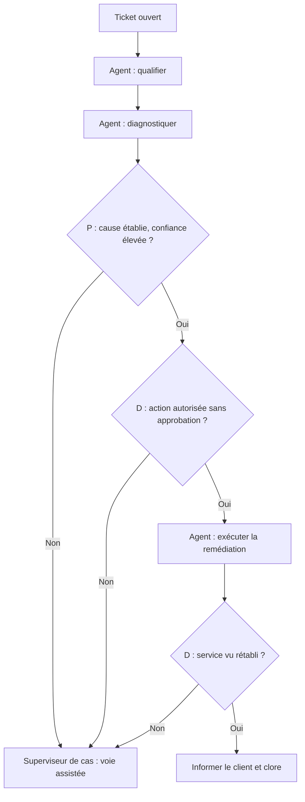

## En bref

BPMN 2.0 (Business Process Model and Notation) est la notation standard des processus : événements, tâches, passerelles, couloirs. Elle a été conçue pour des humains et des systèmes déterministes. Un processus agentique y ajoute une troisième espèce d'exécutant, dont la sortie est probable et non certaine.

Le BPMN augmenté garde la notation et pose une convention par élément pour le dire. Chaque tâche est typée. Chaque passerelle est marquée déterministe ou probabiliste. Chaque approbation humaine, chaque délai et chaque exception sont dessinés.

Pour un FDE, le modèle est un contrat entre le métier et le build. Il répond à la question qui décide de la fiabilité du système : **qu'est-ce qui va dans le code, et qu'est-ce qui est confié à l'agent ?**

## Quand l'utiliser

- En phase [Réinventer](/methode/reinventer), une fois les voies du processus cible arrêtées, pour spécifier chacune.
- En phase [Concevoir](/methode/concevoir), comme source des garde-fous, des règles d'approbation et des cas d'évaluation.
- À chaque changement de règle ou d'autonomie en production : on modifie le modèle d'abord.

Ne pas modéliser l'existant dans ce détail : la [fiche processus](/templates/fiche-processus-existant) suffit pour ce qu'on va reconstruire. Ne pas l'utiliser pour un travail d'exploration sans étapes stables, où un agent tient lui-même le plan : la [fiche agent](/templates/fiche-agent) décrit mieux ce cas.

## Comment l'appliquer

### 1. Dessiner le chemin nominal d'une voie

Un modèle par voie, du déclencheur au résultat, en quinze éléments au plus. Les exceptions viendront à l'étape 5 : les dessiner toutes d'emblée rend le modèle illisible.

### 2. Appliquer les conventions

| Élément BPMN | Usage | Convention pour un processus agentique |
| --- | --- | --- |
| Événement de début | Ce qui déclenche le flux | Un événement daté : message, alarme, échéance. Jamais « quand quelqu'un prend le dossier » |
| Couloir | Qui exécute | Un couloir par exécutant : rôle humain, agent, système |
| Tâche de service | Appel à une application | Déterministe : code ou API, testée, rejouable sans effet double |
| Tâche de règle métier | Décision par table de règles | Garde-fou : règle écrite, versionnée, hors du prompt |
| Tâche utilisateur | Action d'une personne | Point human-in-the-loop : ce que la personne voit, ce qu'elle décide, en combien de temps |
| Tâche d'agent | Travail confié à un modèle | Annotation Maison : niveau d'autonomie, outils autorisés, critère d'évaluation |
| Passerelle exclusive | Aiguillage | Marquée **D** si la condition porte sur des données, **P** si la branche dépend de la sortie d'un modèle |
| Événement de bordure minuteur | Délai de service | Le délai au-delà duquel le cas escalade, et vers qui |
| Événement de bordure erreur | Exception | La voie de repli, avec le dossier transmis |

BPMN ne connaît pas la tâche d'agent : c'est une tâche annotée, pas un nouveau symbole.

### 3. Verrouiller chaque passerelle probabiliste

Une passerelle P porte trois choses, ou elle ne passe pas la revue : un **seuil** (à partir de quelle confiance on prend la branche), une **branche par défaut** qui mène à un humain, et un **critère d'évaluation** qui dira si l'aiguillage est juste.

### 4. Poser les approbations et les délais

Chaque action qui écrit dans une application est précédée d'une passerelle D qui vérifie son droit d'agir, et d'une tâche utilisateur quand le [niveau d'autonomie](/frameworks/niveaux-autonomie) l'exige. Chaque attente d'un humain porte un minuteur : une approbation sans réponse escalade, elle ne vaut jamais accord.

### 5. Ajouter les exceptions et le mode dégradé

Pour chaque tâche, une question : que se passe-t-il si elle échoue, si l'application ne répond pas, si l'agent doute ? Relier chaque cas à une voie de repli. Vérifier que toute action qui écrit a son action inverse, ou une procédure de reprise.

### 6. Extraire le registre des règles

Lister chaque règle, contrôle et condition du modèle, puis la classer.

| Question | Si oui |
| --- | --- |
| La règle est-elle écrite, stable, et porte-t-elle sur des données structurées ? | Garde-fou déterministe |
| Sa violation est-elle inacceptable : loi, sécurité, argent, tiers ? | Garde-fou déterministe, même si l'agent « connaît » la règle |
| Faut-il interpréter un texte, un contexte, un faisceau d'indices ? | Jugement confié à l'agent, avec un seuil et une évaluation |
| L'erreur est-elle impossible à détecter ou à rattraper ? | Approbation humaine avant l'action |

En une phrase : **ce qui doit être toujours vrai va dans le code ; ce qui doit être bon la plupart du temps va dans l'agent, avec un seuil mesuré ; ce qui engage va à une personne.**

### 7. Faire relire, signer, versionner

Le terrain relit le chemin nominal, le FDE Build relit chaque passerelle P : saura-t-on l'évaluer ? Le modèle signé devient la référence. Il change par demande, sous la [gouvernance des processus](/frameworks/gouvernance-processus).

### Ce que le build en fait

| Dans le modèle | Dans le système |
| --- | --- |
| Tâche de service | Un outil exposé à l'agent, avec sa [spécification](/templates/specification-outil) |
| Tâche de règle métier, passerelle D | Un garde-fou codé, couvert par des tests |
| Tâche d'agent | Une [fiche agent](/templates/fiche-agent) et des cas du golden set |
| Passerelle P | Un seuil, un critère du [plan d'évaluation](/templates/plan-evaluation), une escalade |
| Tâche utilisateur | Une règle d'approbation et un écran du poste de supervision |
| Minuteur, erreur | Une alerte, une escalade, une entrée du [runbook](/templates/runbook-agent) |

## Exemple

La voie autonome de Voxalis, pour le motif « perte de synchronisation de l'accès ». Les passerelles sont marquées D ou P.

La passerelle « action autorisée sans approbation ? » regroupe trois conditions codées : action au catalogue à risque faible, aucun incident collectif sur la zone, aucune réclamation ouverte.

Extrait du registre des règles.

| Règle | Classe | Où elle vit |
| --- | --- | --- |
| Aucune action individuelle pendant un incident collectif sur la zone | Garde-fou | Contrôle codé avant tout appel à `reseau.executer_action` |
| Hors du catalogue à risque faible, l'action attend une approbation | Garde-fou | Passerelle D, puis tâche utilisateur du superviseur de cas |
| Test de ligne pendant les heures ouvrées du client : approbation | Garde-fou | Règle d'approbation de l'outil `ligne.lancer_test` |
| Deuxième action sur le service en 24 h, ou trois actions sur le ticket : escalade | Garde-fou | Compteur tenu par l'orchestration du cas |
| Approbation sans réponse en 15 minutes : responsable de plateau | Garde-fou | Minuteur de bordure |
| Le ticket relève-t-il de ce motif ? | Jugement | Agent de qualification ; exactitude d'au moins 95 % |
| La cause est-elle établie ? | Jugement | Agent de diagnostic ; justesse d'au moins 90 %, seuil de confiance calibré sur le golden set |
| Le message du client révèle-t-il un mécontentement ? | Jugement, réglé vers la prudence | Au doute, superviseur de cas |
| Accorder un geste commercial | Décision humaine | Tâche utilisateur, sans exception |

Cinq règles sur neuf vivent dans le code. Aucune injection de prompt ne peut lever l'interdiction d'agir pendant un incident collectif : le modèle ne la porte pas.

## Pièges à éviter

- **Modéliser tout le processus, toutes branches comprises.** Parade : une voie, un chemin nominal, les exceptions en liste.
- **Une passerelle P sans branche par défaut.** L'agent tranchera toujours, même quand il ne sait pas. Parade : seuil, repli vers l'humain, critère d'évaluation.
- **Laisser une règle critique dans le prompt.** Une consigne se contourne, un contrôle codé non. Parade : la deuxième question du registre. Voir les [garde-fous](/frameworks/garde-fous).
- **Des approbations partout, par précaution.** Chaque tâche utilisateur recrée une file d'attente. Parade : l'approbation se justifie par le risque de l'action.
- **Un modèle dessiné puis oublié.** Parade : c'est la référence versionnée ; le système se compare à lui en production.

## Pour aller plus loin

- Guide : [socle transformation métier](/guides/socle-transformation-metier), [repenser un processus en AI-Native](/guides/repenser-un-processus)
- Frameworks : [réinvention à base zéro](/frameworks/reinvention-zero-base), [garde-fous](/frameworks/garde-fous), [niveaux d'autonomie](/frameworks/niveaux-autonomie), [RACI augmenté](/frameworks/raci-augmente), [gouvernance des processus](/frameworks/gouvernance-processus)
- Templates : [fiche de conception de processus agentique](/templates/fiche-conception-processus-agentique), [processus cible AI-Native](/templates/processus-cible-ai-native)
- Référence : Object Management Group, BPMN 2.0, et DMN pour les tables de décision.
