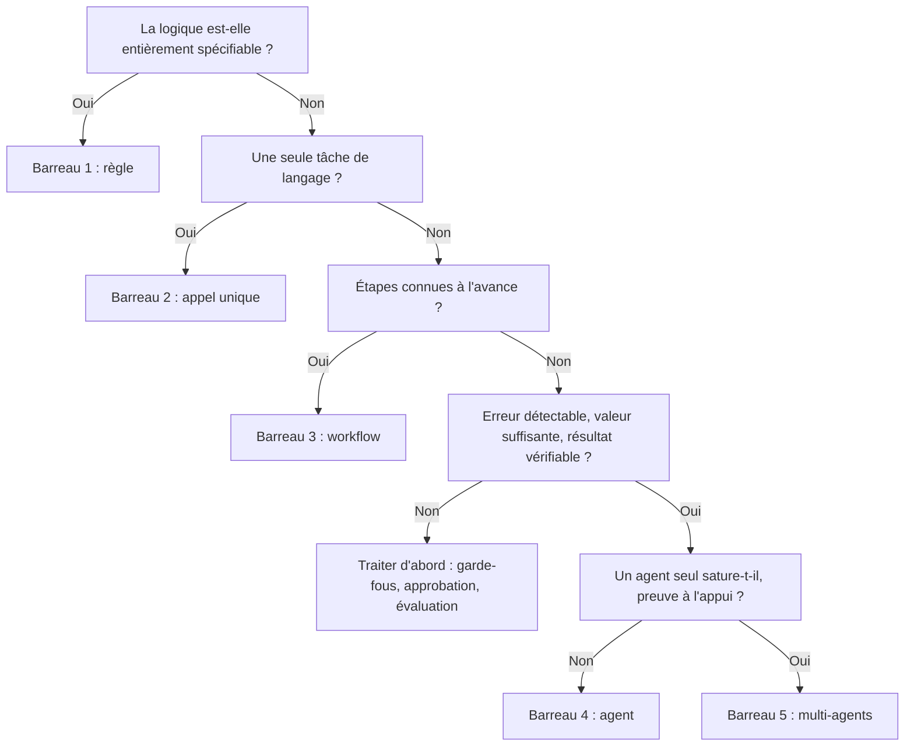

## En bref

Un agent n'est pas un objectif, c'est un moyen coûteux. Il échange de la latence, du coût et de l'imprévisibilité contre la capacité à traiter des situations qu'on ne sait pas décrire à l'avance. L'échelle des solutions range les options de la plus simple à la plus autonome. La règle : **monter d'un barreau seulement quand le précédent a montré ses limites, preuves à l'appui.**

Le FDE qui propose un système multi-agents là où un appel de modèle bien conçu suffit livre plus tard, plus cher, et un système que le client ne saura pas opérer.

## Quand l'utiliser

- En phase [Cibler](/methode/cibler), pour qualifier chaque cas d'usage : la réponse conditionne la faisabilité et le coût.
- En phase [Concevoir](/methode/concevoir), avant toute décision d'architecture, et à chaque fois que quelqu'un dit « il nous faut un agent pour ça ».
- En revue d'un système existant qui déçoit : il est souvent placé un barreau trop haut ou trop bas.

Ne pas l'utiliser pour trancher le niveau de supervision humaine : c'est l'objet des [niveaux d'autonomie](/frameworks/niveaux-autonomie). Un workflow peut agir sans validation, un agent peut être soumis à approbation.

## Comment l'appliquer

### 1. Situer le besoin sur l'échelle

| Barreau | Solution | Qui décide du chemin ? | À retenir quand |
| --- | --- | --- | --- |
| 1 | **Règle ou automatisation déterministe** (script, moteur de règles, RPA) | Le code | Entrées structurées, logique stable et entièrement spécifiable |
| 2 | **Appel de modèle unique**, avec ou sans recherche documentaire | Le code | Une tâche de langage isolée : classer, extraire, résumer, rédiger |
| 3 | **Workflow** : enchaînement, routage ou parallélisation d'appels | Le code | Tâche décomposable en étapes connues à l'avance |
| 4 | **Agent** : un modèle qui choisit ses outils et ses étapes en boucle | Le modèle | Chemin imprévisible, nombre d'étapes variable, besoin d'explorer |
| 5 | **Système multi-agents** | Plusieurs modèles coordonnés | Périmètres, outils ou contextes trop larges pour un seul agent |

La frontière qui compte passe entre les barreaux 3 et 4 : dans un workflow, le code tient le plan ; dans un agent, le modèle le tient.

### 2. Poser les six questions

Répondre par oui ou non, avec un exemple réel à l'appui.

1. **Le chemin varie-t-il d'un cas à l'autre** au point qu'on ne peut pas l'écrire en moins de dix branches ?
2. **Les entrées sont-elles ambiguës ou non structurées** (texte libre, pièces jointes, conversation) ?
3. **La tâche exige-t-elle d'interroger plusieurs systèmes** dans un ordre qui dépend de ce qu'on y trouve ?
4. **Une erreur est-elle détectable et réversible** avant de causer un dommage ?
5. **La valeur unitaire d'un cas traité justifie-t-elle** quelques dizaines de centimes et plusieurs dizaines de secondes ?
6. **Sait-on vérifier objectivement que le résultat est bon** ?

Lecture : un « non » aux questions 1 à 3 plafonne la solution au barreau 3. Un « non » à l'une des questions 4 à 6 interdit le barreau 4 tant qu'il n'est pas traité, par des garde-fous, une approbation humaine ou la construction d'une évaluation.

### 3. Passer au multi-agents seulement sur preuve

Découper en plusieurs agents se justifie par l'un de ces constats, mesuré sur un agent unique : la précision s'effondre au-delà d'un certain nombre d'outils, le contexte sature, deux sous-tâches exigent des droits d'accès différents, ou des traitements indépendants gagnent à tourner en parallèle. Sans l'un de ces constats, rester à un agent.

### 4. Documenter la décision

Consigner le barreau retenu, les barreaux écartés et la raison dans un [ADR](/templates/adr). Noter aussi le signal qui déclencherait une montée d'un barreau.

## Exemple

Chez Voxalis, les cinq cas d'usage retenus ne se situent pas au même barreau.

| Cas d'usage | Barreau | Justification |
| --- | --- | --- |
| Qualification et routage des tickets | 2 | Une tâche de classification et d'extraction, résultat vérifiable sur 600 cas annotés |
| Communication proactive | 3 | Étapes connues : lire l'état du cas, choisir un gabarit, rédiger, contrôler, envoyer |
| Diagnostic technique | 4 | L'ordre des vérifications dépend de ce que révèlent la supervision et le test de ligne |
| Résolution des motifs récurrents | 4 | Choix d'actions selon le diagnostic, avec approbation au-delà du catalogue à risque faible |
| Ensemble du flux | 5 | Droits d'accès distincts (lecture seule pour le diagnostic, écriture pour la résolution) et contextes spécialisés |

Le prototype a d'ailleurs commencé avec un agent unique. La séparation Diagnostic et Résolution n'a été décidée qu'après avoir mesuré que la justesse du diagnostic passait de 91 % à 84 % quand le même agent portait aussi les neuf outils et les règles de remédiation.

## Pièges à éviter

- **Choisir l'agent pour la démonstration.** Un agent impressionne en comité et déçoit en production. Parade : exiger le résultat du barreau inférieur sur le golden set avant d'arbitrer.
- **Confondre agent et autonomie.** « Agent » décrit qui tient le plan, pas qui valide. Parade : traiter les deux décisions séparément et les documenter séparément.
- **Découper en agents selon l'organigramme.** Un agent par service reproduit les silos et multiplie les passages de relais. Parade : découper selon les contextes, les outils et les droits.
- **Ignorer le coût d'exploitation.** Chaque barreau ajoute du traçage, des évaluations et de l'astreinte. Parade : chiffrer le coût récurrent dans le [business case](/templates/business-case) avant de décider.
- **Rester bloqué en bas de l'échelle par prudence.** Empiler quarante branches dans un workflow pour éviter un agent produit un système plus fragile que l'agent. Parade : la question 1 fixe la limite.

## Pour aller plus loin

- Outil interactif : [Agent ou pas ?](/outils/agent-ou-pas)
- Frameworks : [patterns agentiques](/frameworks/patterns-agentiques), [topologies multi-agents](/frameworks/topologies-multi-agents), [niveaux d'autonomie](/frameworks/niveaux-autonomie)
- Templates : [fiche agent](/templates/fiche-agent), [ADR](/templates/adr)
- Référence : Anthropic, « Building Effective Agents » — la distinction entre workflows et agents, et le principe de la solution la plus simple possible.
