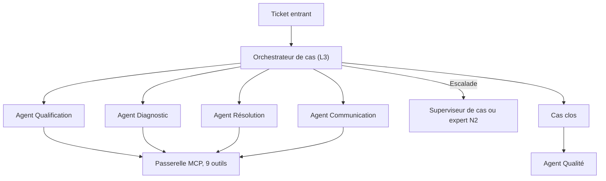

## En bref

Un système multi-agents se justifie quand un agent seul sature : trop d'outils, contexte trop large, droits d'accès incompatibles, traitements parallélisables. Une fois ce seuil franchi, la vraie décision est la **topologie** : qui décide de la suite, qui tient l'état, qui parle à qui. Chaque relais entre agents coûte de la latence, des jetons et de l'information perdue. La bonne topologie est celle qui minimise ces relais tout en gardant l'état du cas traçable.

Pour un FDE, la topologie conditionne l'auditabilité, le coût d'exploitation et la capacité du client à opérer le système seul.

## Quand l'utiliser

- En phase [Concevoir](/methode/concevoir), après avoir établi, preuve à l'appui, qu'un agent unique ne suffit pas (barreau 5 de [l'échelle des solutions](/frameworks/faut-il-un-agent)).
- Quand un système existant devient imprévisible : agents qui se renvoient le cas, état incohérent, coût par cas qui dérive.

Ne pas l'utiliser pour justifier a priori un découpage en plusieurs agents. Sans saturation mesurée, voir [multi-agents prématuré](/savoir/multi-agents-premature).

## Comment l'appliquer

### 1. Choisir la topologie

| Topologie | Principe | Forces | Faiblesses | À retenir quand |
| --- | --- | --- | --- | --- |
| **Superviseur** | Un orchestrateur délègue à des spécialistes et reprend la main après chaque tâche | État centralisé, traçabilité, escalade simple | Goulot d'étranglement, l'orchestrateur porte beaucoup de contexte | Flux métier avec décisions de bascule et exigence d'audit |
| **Hiérarchique** | Superviseurs de superviseurs | Passe à l'échelle sur de grands périmètres | Latence et perte d'information à chaque niveau | Plusieurs domaines, chacun avec sa propre équipe d'agents |
| **Pipeline** | Agents en séquence fixe, chacun transmet au suivant | Simple, évaluable étape par étape | Rigide, aucun retour arrière | Flux linéaire et stable, sans branchement |
| **Réseau pair-à-pair** | Chaque agent passe le relais à celui qu'il juge compétent | Souple, pas de point central | État dispersé, boucles, audit difficile | Conversations ouvertes où le bon interlocuteur change souvent |
| **Espace partagé (tableau noir)** | Les agents lisent et écrivent dans un état commun, sans s'adresser directement | Découplage, contributions asynchrones | Conflits d'écriture, coordination implicite | Problèmes d'exploration où plusieurs expertises enrichissent une même hypothèse |

Règle par défaut : **commencer par le superviseur**, et n'en sortir que sur un motif nommé.

### 2. Définir l'état partagé

Décider explicitement : où vit l'état du cas, qui a le droit d'y écrire, selon quel schéma. Une seule source de vérité. Les agents spécialisés reçoivent une **projection** de l'état utile à leur tâche, jamais l'historique complet.

### 3. Spécifier les contrats entre agents

Pour chaque relais : entrée et sortie structurées, validées par schéma, avec un champ de confiance et la liste des informations manquantes. Un relais en texte libre est un relais où l'information se perd.

### 4. Chiffrer le coût de coordination

Compter, sur des cas réels, le nombre de relais par cas, la latence ajoutée et le coût des jetons de coordination. Si l'orchestration dépasse le travail utile, la topologie est trop fine.

## Exemple

SAV Augmenté suit une topologie à superviseur.

Les raisons du choix, consignées dans le [dossier d'architecture](/templates/dossier-architecture-multi-agents) :

- **Le choix de la voie est une décision centrale.** Autonome, assistée ou experte : elle doit être prise et tracée en un seul point.
- **Le pipeline était trop rigide.** Un diagnostic à confiance faible doit revenir à l'Orchestrateur pour escalade, pas avancer vers la résolution.
- **Le pair-à-pair était inauditable.** Une action sur le réseau doit pouvoir être reliée à la décision qui l'a déclenchée.
- **L'état du cas vit dans le ticket du CRM**, mis à jour par l'Orchestrateur via `crm.mettre_a_jour_ticket`. L'Agent Diagnostic reçoit le ticket qualifié, pas l'historique des échanges avec le client.
- **L'Agent Qualité est découplé** : il intervient après clôture, hors du chemin critique, sans rallonger le délai de résolution.

## Pièges à éviter

- **Découper selon l'organigramme.** Un agent par service reproduit les quatre passages de relais du processus existant. Parade : découper selon les contextes, les outils et les droits.
- **Laisser l'état se disperser.** Chaque agent garde sa version du cas et elles divergent. Parade : une source de vérité, écrite par un seul acteur.
- **Relais en langage naturel.** Parade : contrats structurés et validés par schéma entre agents.
- **Orchestrateur obèse.** Il accumule les règles métier de tous les agents et sature. Parade : il décide de la suite, les spécialistes portent l'expertise.
- **Ignorer le coût de coordination.** Parade : mesurer relais et coût par cas dès le prototype.

## Pour aller plus loin

- Frameworks : [faut-il un agent ?](/frameworks/faut-il-un-agent), [patterns agentiques](/frameworks/patterns-agentiques), [protocoles MCP et A2A](/frameworks/protocoles-mcp-a2a), [context engineering](/frameworks/context-engineering)
- Templates : [dossier d'architecture multi-agents](/templates/dossier-architecture-multi-agents), [fiche agent](/templates/fiche-agent)
- Cas : [la mission Voxalis](/guides/cas-fil-rouge)
