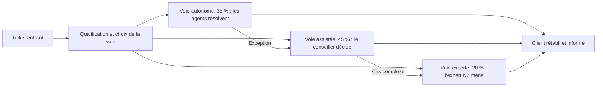

## Le résultat visé

Un [processus cible](/templates/processus-cible-ai-native) que le métier reconnaît comme le sien et valide au jalon G3 de la phase [Réinventer](/methode/reinventer) : un résultat énoncé du point de vue du client, des voies avec leurs critères d'entrée et leur part du volume, une répartition des tâches entre humains et agents, un niveau d'autonomie par action. Compter trois à quatre semaines ; chez [Voxalis](/guides/cas-fil-rouge), S10 à S13.

Le point de départ est la [fiche du processus existant](/templates/fiche-processus-existant) issue du diagnostic. Chez Voxalis : 9 étapes, 4 passages de relais, 6 outils, et un MTTR de 31 h dont 41 % d'attente entre N1 et N2.

> [!WARNING]
> Placer un agent derrière chaque étape existante, c'est [automatiser l'existant](/savoir/automatiser-l-existant) : les passages de relais et les files d'attente restent, le travail arrive seulement plus vite à la file suivante.

## La démarche en six étapes

### 1. Partir du résultat

Ranger la cartographie. Écrire avec le propriétaire du processus le résultat attendu, en une phrase, du point de vue de celui qui le reçoit. Voxalis : « un client rétabli et informé ». Ni « un ticket clos », ni « un incident qualifié ».

Questions d'atelier, tirées de la [réinvention à base zéro](/frameworks/reinvention-zero-base) :

- « Si nous créions ce service aujourd'hui, sans l'organigramme ni les outils actuels, que ferions-nous ? »
- « Qu'attend vraiment le client, et à quel moment ? »
- « Quelles étapes n'existent que parce qu'une information manquait au bon endroit ? »

### 2. Décomposer les tâches

Reprendre chaque étape de l'existant et la découper en tâches ([décomposition des tâches](/frameworks/decomposition-taches)). Pour chacune, trancher dans cet ordre.

| Décision | Critère | Exemple Voxalis |
| --- | --- | --- |
| Supprimer | La tâche ne sert pas le résultat : attente, ressaisie, transfert | L'attente entre N1 et N2, 41 % du délai |
| Fusionner | Deux tâches séparées par un passage de relais | Qualification et collecte d'informations |
| Confier à un agent | Volume élevé, information accessible par outil, résultat vérifiable | Interroger supervision, test de ligne et inventaire |
| Garder à l'humain | Jugement, relation, responsabilité engagée | Geste commercial, cas inédit |

Supprimer d'abord. Une attente ne s'automatise pas : elle disparaît quand l'information est disponible là où se prend la décision.

### 3. Définir les voies

Segmenter le flux selon la prévisibilité et le risque des cas, pas selon l'organigramme. Chaque voie a un critère d'entrée testable, une part du volume et une règle de bascule vers la voie supérieure.

La part de chaque voie se déduit des données du diagnostic, pas d'une ambition : chez Voxalis, 12 motifs récurrents à la résolution documentée concentrent 58 % des incidents. Écrire le critère d'entrée comme une règle. Par exemple, pour une voie autonome : motif appartenant au catalogue, action de remédiation réversible, aucun doute sur l'identité du service touché.

### 4. Répartir humains et agents

Pour chaque tâche de chaque voie, dire qui exécute, qui décide, qui contrôle : c'est l'objet de la [matrice humain-agent](/templates/matrice-humain-agent) et du [RACI augmenté](/frameworks/raci-augmente). Deux exigences.

- **Concevoir le poste humain comme un métier**, pas comme un bouton de validation. Chez Voxalis, le conseiller devient superviseur de cas : il décide sur la voie assistée, contrôle la voie autonome par échantillonnage, reprend les exceptions. Les conséquences sur les rôles et les effectifs vont au [modèle opérationnel cible](/templates/modele-operationnel-cible).
- **Concevoir les passages de relais entre agent et humain** ([collaboration humain-agent](/frameworks/collaboration-humain-agent)). Quand l'agent escalade, que reçoit l'humain : un dossier complet (diagnostic, éléments consultés, action proposée, raison de l'escalade) ou un ticket à reprendre de zéro ?

### 5. Fixer l'autonomie

Le [niveau d'autonomie](/frameworks/niveaux-autonomie) se fixe par action et par situation, jamais globalement. Trois questions par action : l'erreur est-elle réversible ? Est-elle détectable avant de toucher le client ? Que coûte-t-elle au pire ?

Chez Voxalis, le diagnostic agit en L3 parce qu'il ne fait que lire. La résolution est en L3 sur le catalogue d'actions à risque faible et en L2, avec approbation humaine, au-delà. Les messages de statut partent en L3 ; tout geste commercial reste en L2. Écrire aussi la trajectoire : quelle preuve autorisera l'élargissement (voir [autonomie progressive](/savoir/autonomie-progressive)).

### 6. Tester la cible avec le terrain

Avant toute validation, rejouer sur papier vingt à trente cas réels déjà clos, avec des opérationnels : des cas simples, des cas tordus, des cas qui ont mal fini. Pour chacun :

- « Dans quelle voie entre-t-il, et sur quel critère ? »
- « Qui fait quoi, avec quelle information ? »
- « Où cela casse-t-il ? »

Chez Voxalis, l'exercice s'appuie sur les deux experts N2 détachés et sur des conseillers du plateau de Nantes. Corriger la cible, puis seulement la présenter : au propriétaire du processus pour validation, à la DRH pour ce qui touche aux métiers. L'outil [Redesign de processus](/outils/redesign-processus) tient la comparaison entre l'existant et la cible.

## Erreurs fréquentes

- **Garder les étapes et changer les exécutants.** Parade : commencer par le résultat, cartographie fermée.
- **Dessiner les voies selon les équipes.** Une voie « N1 » et une voie « N2 » reproduisent l'organisation. Parade : des critères d'entrée fondés sur le cas, pas sur le service.
- **Faire de l'humain un valideur en série.** Approuver des centaines de propositions par jour, c'est ne plus rien contrôler. Parade : l'approbation là où le risque l'exige, l'échantillonnage ailleurs.
- **Oublier les exceptions.** La cible ne décrit que le cas nominal. Parade : une règle de bascule par voie, éprouvée à l'étape 6.
- **Concevoir en chambre.** Une cible découverte en formation sera contournée : c'est l'anti-pattern de l'[humain oublié](/savoir/humain-oublie).
- **Taire ce que devient la capacité libérée.** La question arrive dès la première présentation ; voir [Embarquer les équipes et traiter les résistances](/guides/gerer-resistances).

## Checklist

- [ ] Le résultat du processus tient en une phrase, du point de vue du client.
- [ ] Chaque tâche de l'existant est classée : supprimée, fusionnée, confiée à un agent, gardée à l'humain.
- [ ] Les attentes et les passages de relais supprimés sont chiffrés.
- [ ] Chaque voie a un critère d'entrée testable, une part du volume fondée sur les données et une règle de bascule.
- [ ] Le poste humain cible est décrit comme un métier.
- [ ] Chaque escalade d'un agent précise ce que l'humain reçoit.
- [ ] L'autonomie est fixée action par action, avec la preuve qui permettra de l'élargir.
- [ ] Vingt à trente cas réels ont été rejoués sur la cible avec des opérationnels.
- [ ] Le propriétaire du processus a validé la cible ; la DRH a validé l'évolution des métiers.
