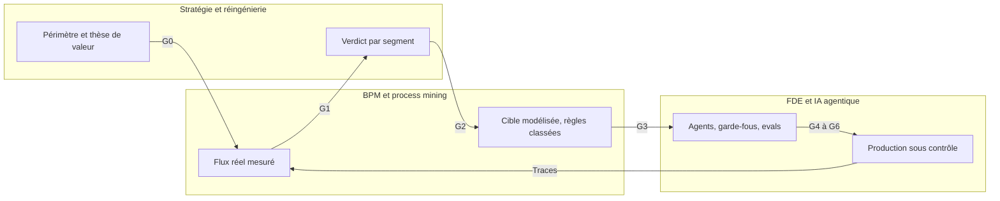

## Le résultat visé

Passer de « construire un agent sur un besoin flou » à « réinventer le flux de bout en bout, puis l'industrialiser ». À la fin, chaque agent construit sait dire de quel flux mesuré il vient, quelle règle le borne et quel indicateur il doit faire bouger.

Ce socle est le côté Design du métier : celui que porte le FDE Design dans un binôme, ou la moitié « métier » d'un FDE seul. Un cabinet parlerait d'architecte métier et d'ingénieur ; le portail dit FDE Design et FDE Build.

Il ne crée pas une seconde méthode. Il outille les phases 0 à 3 du [Parcours AI-Native](/methode), et installe ce qui tient le processus après le départ de l'équipe.

## La chaîne en trois maillons

La chaîne n'est pas une cascade. La stratégie pose une question, la mesure y répond, la stratégie tranche, le modèle spécifie, le build construit. Les traces de production reviennent alimenter la mesure : le diagnostic du premier jour devient l'instrument de contrôle du dernier.

## Ce que nous gardons des grands cabinets

| Source | Ce que nous en gardons | Ce que l'agentique y change | Où dans le portail |
| --- | --- | --- | --- |
| McKinsey : le flux d'abord, l'organisation agentique | La valeur vient du flux redessiné, pas de l'agent ; un flux combine règles, analytique, IA générative et agents ; les rôles et les droits de décision se redéfinissent | Le droit de décision se fixe par action et par niveau de risque | [Grille de décision](/frameworks/eliminer-automatiser-agentifier), [RACI augmenté](/frameworks/raci-augmente), [modèle opérationnel](/frameworks/modele-operationnel-cible) |
| BCG : remodeler de bout en bout et la règle 10-20-70 | Remodeler une fonction entière plutôt que déployer des outils ; mettre 70 % de l'effort sur les personnes et les processus | La règle sert aussi à lire les indicateurs, par étages | [Déployer, Remodeler, Inventer](/frameworks/deploy-reshape-invent), [règle 10-20-70](/frameworks/regle-10-20-70) |
| Bain : le zero-based redesign et la création de valeur | Repartir d'une feuille blanche : rien ne survit parce qu'il existait ; supprimer avant d'automatiser ; retirer les couches de coordination ; classer par effet sur le résultat | Un agent rend un gaspillage presque gratuit, donc invisible : on supprime d'abord | [Réinvention à base zéro](/frameworks/reinvention-zero-base), [carte de flux de valeur](/frameworks/value-stream-mapping), [arbre de valeur](/frameworks/arbre-de-valeur) |
| Accenture : le digital core et la continuité numérique | Un cas, un identifiant, des données continues d'un système à l'autre | Le fil enregistre aussi les décisions des agents et nourrit les évaluations | [Fil numérique](/frameworks/fil-numerique) |
| Lean Six Sigma et process mining, tels que les pratiquent les cabinets d'excellence opérationnelle comme Deloitte | Les traces d'exécution avant les ateliers ; le cycle DMAIC | Améliorer inclut des agents, contrôler inclut leur dérive | [Process mining et DMAIC augmenté](/frameworks/process-mining-dmaic) |
| APQC, BPMN, BPM | Une taxonomie, une notation, un propriétaire de processus | La notation distingue le déterministe du probabiliste | [Architecture de processus](/frameworks/architecture-processus), [BPMN augmenté](/frameworks/bpmn-agentique), [gouvernance des processus](/frameworks/gouvernance-processus) |

## Le playbook en cinq étapes

### Étape 1 — Situer le périmètre et la thèse de valeur

Phase [Cadrer](/methode/cadrer), jalon G0.

- **Philosophie.** On ne cadre pas un agent. On cadre un processus et le poste du compte de résultat qu'il déplace.
- **Étapes et outils.** Situer le domaine sur les quatre niveaux de l'[architecture de processus](/frameworks/architecture-processus). Relier le processus à un résultat financier par l'[arbre de valeur](/frameworks/arbre-de-valeur). Relire le plan avec la [règle 10-20-70](/frameworks/regle-10-20-70). Nommer le propriétaire du processus.
- **Livrables.** La [charte de mission](/templates/charte-de-mission), avec le périmètre par niveaux et les interfaces.
- **Binôme.** Le FDE Design mène. Le FDE Build relève les applications qui portent le processus et les traces qu'elles gardent.
- **Passage.** Le périmètre est situé du macro-processus à l'activité ; un propriétaire répond du processus de bout en bout ; l'ordre de grandeur de la valeur est écrit.

### Étape 2 — Mesurer le flux réel

Phase [Diagnostiquer](/methode/diagnostiquer), jalon G1.

- **Philosophie.** Les traces avant les ateliers. Ce que les gens disent du processus est une hypothèse ; ce que les applications ont enregistré est un fait.
- **Étapes et outils.** Extraire le journal d'événements et reconstituer parcours, attentes et boucles par le [process mining](/frameworks/process-mining-dmaic). Observer le terrain pour ce que les traces cachent. Classer chaque étape avec la [carte de flux de valeur](/frameworks/value-stream-mapping). Relever les ruptures du [fil numérique](/frameworks/fil-numerique).
- **Livrables.** Le [diagnostic de flux par les traces](/templates/diagnostic-flux-traces) et la [fiche processus existant](/templates/fiche-processus-existant).
- **Binôme.** Le FDE Build extrait et reconstitue. Le FDE Design interprète, classe et restitue.
- **Passage.** Parcours, attentes et boucles sont chiffrés ; chaque étape est classée ; la référence est signée par le métier et la finance.

### Étape 3 — Trancher, segment par segment

Phase [Cibler](/methode/cibler), jalon G2.

- **Philosophie.** Supprimer avant d'automatiser, automatiser avant d'agentifier. La question n'est pas « où mettre un agent ? » mais « que reste-t-il à faire, une fois le flux nettoyé ? ».
- **Étapes et outils.** Rendre un verdict par segment avec la [grille de décision](/frameworks/eliminer-automatiser-agentifier). Chiffrer à part la valeur acquise sans IA. Fixer le niveau de solution des segments agentifiés avec l'[échelle des solutions](/frameworks/faut-il-un-agent). Classer par effet sur le résultat.
- **Livrables.** Les verdicts du diagnostic, le [portefeuille priorisé](/templates/portefeuille-priorise), le [business case](/templates/business-case).
- **Binôme.** Le FDE Design propose les verdicts et la valeur. Le FDE Build qualifie la faisabilité et le niveau de solution.
- **Passage.** Chaque segment a un verdict fondé sur un fait ; les suppressions sont validées par le propriétaire du processus ; le business case ne crédite pas les agents d'un gain qu'ils n'ont pas produit.

### Étape 4 — Redessiner et spécifier

Phase [Réinventer](/methode/reinventer), jalon G3.

- **Philosophie.** Une feuille blanche pour le flux, un modèle pour le contrat. Une cible que le build doit réinterpréter n'est pas une cible.
- **Étapes et outils.** Reconstruire à partir du résultat par la [réinvention à base zéro](/frameworks/reinvention-zero-base). Modéliser chaque voie en [BPMN augmenté](/frameworks/bpmn-agentique). Classer chaque règle : garde-fou, jugement ou décision humaine. Fixer les droits de décision avec le [RACI augmenté](/frameworks/raci-augmente).
- **Livrables.** Le [processus cible](/templates/processus-cible-ai-native), la [matrice humain-agent](/templates/matrice-humain-agent), le [modèle opérationnel cible](/templates/modele-operationnel-cible), et une [fiche de conception](/templates/fiche-conception-processus-agentique) par segment à construire.
- **Binôme.** Le FDE Design tient le modèle et les règles. Le FDE Build relit chaque passerelle probabiliste avec une seule question : saura-t-on l'évaluer ?
- **Passage.** Chaque règle est classée ; chaque indicateur a un critère d'acceptation ; la fiche de conception est signée par le propriétaire du processus et par les deux FDE.

### Étape 5 — Industrialiser et tenir

Phases [Concevoir](/methode/concevoir) à [Pérenniser](/methode/perenniser), jalons G4 à G7.

- **Philosophie.** Un processus se gouverne. Sans propriétaire ni plan de contrôle, le résultat du pilote s'érode.
- **Étapes et outils.** Porter les garde-fous dans le code et les critères d'acceptation dans le [plan d'évaluation](/templates/plan-evaluation). Tirer le [fil numérique](/frameworks/fil-numerique) : identifiant du cas, journal des décisions. Installer la [gouvernance des processus](/frameworks/gouvernance-processus). Rejouer l'analyse des traces en production.
- **Livrables.** Les [fiches agents](/templates/fiche-agent), le plan d'évaluation, puis le [plan de contrôle du processus](/templates/plan-de-controle-processus).
- **Binôme.** Le FDE Build construit et instrumente. Le FDE Design tient la conformité à la cible, l'adoption et le transfert du plan de contrôle.
- **Passage.** Au G4, chaque garde-fou du registre a sa place dans le code, hors du prompt, et son test est écrit. Au G5, les garde-fous sont codés et testés. Au G6, le propriétaire tient le plan de contrôle. Au G7, le client a animé seul une revue de performance, et la première revue d'amélioration, qui rejoue l'analyse des traces, est datée.

## Les trois ponts vers le build

| Pont | Le livrable métier | Ce qu'il devient côté build | Le détail |
| --- | --- | --- | --- |
| 1. Du diagnostic au cadrage | Parcours réels, tri de la valeur, verdicts | Les voies et leur dimensionnement, le tirage du golden set, la référence, la liste des outils à exposer, et ce qu'on ne construit pas | [Process mining et DMAIC augmenté](/frameworks/process-mining-dmaic) |
| 2. Du modèle aux garde-fous | Modèle du processus et registre des règles | Du code testé pour ce qui doit être toujours vrai ; un agent, un seuil et une évaluation pour ce qui relève du jugement ; une approbation pour ce qui engage | [BPMN augmenté](/frameworks/bpmn-agentique) |
| 3. Des indicateurs aux evals | Indicateurs cibles du processus | Des critères d'acceptation, repris dans le plan d'évaluation puis dans le plan de contrôle | Ci-dessous |

### Le troisième pont, pas à pas

Un indicateur métier ne s'évalue pas tel quel : un golden set ne mesure pas un délai. Il faut le traduire en comportement vérifiable.

| Indicateur du processus chez Voxalis | Comportement attendu du système | Critère d'acceptation |
| --- | --- | --- |
| Délai de résolution de 31 h à 12 h | Aucune attente humaine sur la voie autonome | Délai cible de 1,5 h sur la voie, mesuré en production |
| Résolution au premier contact de 54 % à 75 % | Le diagnostic est juste du premier coup | Justesse du diagnostic d'au moins 90 % sur le golden set |
| Erreur de qualification de 9 % | Le ticket part dans la bonne voie | Exactitude de la qualification d'au moins 95 % |
| Aucun incident causé par le système | Aucune action hors règle | Zéro action inappropriée sur le jeu adverse |
| Réouverture de 14 % à 7 % | Le rétablissement est vérifié avant clôture | Indicateur garde-fou, suivi en production |

Les mêmes indicateurs se retrouvent ensuite dans le plan de contrôle. De la référence à la production, la mesure ne change pas de définition.

## La grille de décision, en bref

| | Travail spécifiable | Travail de jugement |
| --- | --- | --- |
| **Flux sain** | Automatiser | Agentifier |
| **Flux dégradé** | Réingénierer, puis automatiser | Réingénierer, puis agentifier |

Avant la matrice, un filtre : ce qui n'a ni valeur pour le client ni obligation réelle est supprimé. Les signaux, les seuils et l'exemple complet sont dans la [grille de décision](/frameworks/eliminer-automatiser-agentifier).

## Indicateurs et gouvernance : lire en 10-20-70

| Étage | Ce qu'on y lit | Exemples |
| --- | --- | --- |
| 70 — Processus et personnes | Le client est-il mieux servi, et les équipes travaillent-elles dans le nouveau flux ? | Temps de cycle, coût par transaction, taux de reprise, taux d'intervention humaine, adoption |
| 20 — Technologie et données | Le système d'information tient-il ? | Disponibilité des outils, fraîcheur des connaissances, coût d'inférence par cas |
| 10 — Modèles et agents | Les agents font-ils toujours ce qui a été validé ? | Scores d'évaluation, dérive, escalades, actions inappropriées |

La revue se lit du haut vers le bas. Un indicateur du bas ne se commente que s'il explique un indicateur du haut. Le tableau complet et les règles de décision sont dans la [gouvernance des processus](/frameworks/gouvernance-processus).

## Erreurs fréquentes

- **Sauter les étapes 2 et 3 parce que le client « connaît son processus ».** Il connaît la procédure. Chez Voxalis, la demande visait l'étape qui pesait 0,1 h sur 31.
- **Confier la mesure au seul Design, ou au seul Build.** L'un ne sait pas extraire, l'autre ne sait pas quoi chercher.
- **Garder les verdicts de suppression pour plus tard.** Ils sont les moins chers et les plus contestés : ils se tranchent au jalon G2, pas en production.
- **Remettre au build un processus cible sans fiche de conception.** Le build recrée alors les règles à sa façon, dans les prompts.
- **Considérer la gouvernance comme un sujet de fin de mission.** Le propriétaire du processus se nomme à l'étape 1.

## Checklist

- [ ] Le périmètre est situé sur quatre niveaux, avec ses interfaces.
- [ ] Le diagnostic repose sur des traces, recoupées par l'observation.
- [ ] Chaque étape est classée : valeur ajoutée, nécessaire, gaspillage.
- [ ] Chaque segment a un verdict, et les suppressions sont décidées.
- [ ] La valeur acquise sans IA est comptée à part.
- [ ] Chaque voie a un modèle, et chaque règle une classe.
- [ ] Chaque indicateur a un critère d'acceptation, repris dans le plan d'évaluation.
- [ ] Le système émet les traces qui permettent de rejouer le diagnostic.
- [ ] Un propriétaire tient le plan de contrôle, et le client anime la revue seul.
