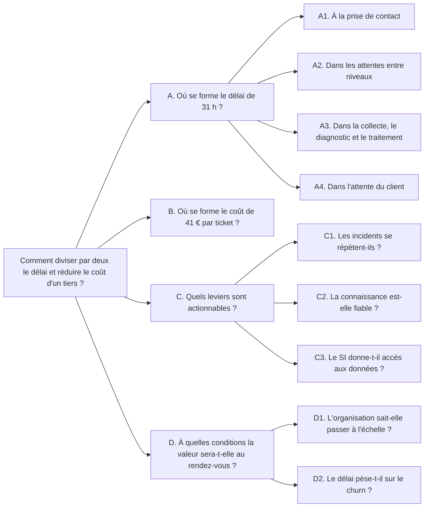

<!-- section: mode-emploi -->
## À quoi ça sert

L'arbre d'hypothèses est le plan de travail intellectuel de la mission. Il empêche deux dérives : exécuter la solution demandée sans vérifier le problème, et diagnostiquer pendant des semaines sans conclure. Chaque entretien, chaque extraction de données, chaque observation se rattache à une hypothèse, ou sort du plan.

## Quand l'utiliser

Dès le troisième jour du [cadrage](/methode/cadrer), puis chaque semaine jusqu'au jalon G1. Il applique la méthode [problème et hypothèses](/frameworks/probleme-hypotheses) et alimente la [charte de mission](/templates/charte-de-mission) ainsi que les [guides d'entretien](/templates/guide-entretien).

## Comment le remplir

1. Écrire l'énoncé du problème avec le sponsor. Si la question clé nomme une technologie, remonter d'un cran.
2. Découper la question en trois à cinq branches sans recouvrement ni oubli (MECE).
3. Poser la réponse la plus probable, par écrit, avant les preuves.
4. Écrire une ligne d'analyse par hypothèse, avec le résultat qui la ferait tomber. Fixer ce seuil avant de regarder les données.
5. Chaque semaine, donner un verdict : confirmée, nuancée ou tuée. Consigner la preuve et la date dans le journal.
6. Si la réponse initiale tombe, réécrire la question clé.

## Critères de qualité

- [ ] La question clé contient un résultat chiffré et aucun nom de solution.
- [ ] Les branches sont MECE : si toutes étaient résolues, le problème le serait.
- [ ] Chaque hypothèse est réfutable, avec un seuil écrit à l'avance.
- [ ] Chaque analyse a une source, un responsable et une échéance.
- [ ] Au moins une hypothèse teste le présupposé de la demande initiale.
- [ ] Les hypothèses tuées figurent au journal, avec leur preuve.

<!-- section: template -->
# Arbre d'hypothèses et plan d'analyse — {{client}}

| | |
| --- | --- |
| **Mission** | {{mission}} |
| **Domaine** | {{domaine}} |
| **Sponsor** | {{sponsor}} |
| **Version** | _[1]_ du {{date}} |
| **Rédacteur** | {{auteur}} |
| **Rythme de revue** | _[Chaque semaine, en point hebdomadaire]_ |

## 1. Énoncé du problème

| Rubrique | Contenu |
| --- | --- |
| Demande initiale | _[La demande telle qu'elle a été formulée, entre guillemets]_ |
| Contexte | _[Trois faits chiffrés qui rendent le sujet urgent]_ |
| Décideur | _[Une personne nommée : celle qui tranchera]_ |
| Critères de succès | _[Deux ou trois indicateurs, avec référence et cible]_ |
| Contraintes | _[Ce qui n'est pas négociable : budget, délai, cadre social et réglementaire, SI existant]_ |
| Périmètre | _[Ce qui est dedans, ce qui est dehors]_ |
| Sources de vérité | _[Les données et les personnes qui feront foi]_ |

## 2. Question clé

> _[Une seule question. Elle commence par « comment », contient un résultat chiffré et ne nomme aucune solution.]_

## 3. Arbre de questions

_[Trois à cinq branches MECE, chacune découpée jusqu'à ce qu'une analyse puisse y répondre. Découper par la mécanique du résultat (un délai en étapes, un coût en volume × coût unitaire) ou par le parcours.]_

- **A.** _[Sous-question]_
  - A1. _[Question à laquelle une analyse peut répondre]_
  - A2.
- **B.** _[Sous-question]_
  - B1.
  - B2.
- **C.** _[Sous-question]_
  - C1.
  - C2.

**Test d'exhaustivité** : _[Si toutes les branches étaient résolues, le problème le serait-il ? Sinon, quelle branche manque ?]_

## 4. Hypothèse de réponse initiale

**Posée le** : _[Date, au plus tard en fin de première semaine]_

**Réponse** : _[La réponse la plus probable à la question clé, en une ou deux phrases.]_

**Elle repose sur** :

1. _[Hypothèse d'appui, rattachée à une branche]_
2. _[Hypothèse d'appui]_
3. _[Hypothèse d'appui]_

**Si elle est vraie** : _[Ce que la mission fera.]_

**Si elle est fausse** : _[Ce que la mission fera à la place.]_

## 5. Plan d'analyse

| N° | Branche | Hypothèse | Analyse | Données et source | Ce qui la ferait tomber | Responsable | Échéance | Statut |
| --- | --- | --- | --- | --- | --- | --- | --- | --- |
| H1 | | _[Affirmation réfutable]_ | _[Le calcul ou l'observation qui départage]_ | | _[Seuil fixé avant l'analyse]_ | | | _[À tester / En cours / Confirmée / Nuancée / Tuée]_ |
| H2 | | | | | | | | |

**Résultats**

| N° | Verdict | Preuve | Conséquence pour la mission |
| --- | --- | --- | --- |
| H1 | | _[Chiffre et source]_ | |

## 6. Journal d'évolution des hypothèses

| Date | Ce qui s'est passé | Effet sur l'arbre |
| --- | --- | --- |
| | _[Entretien, analyse, décision]_ | _[Hypothèse ajoutée, précisée, confirmée ou tuée]_ |

## 7. Réponse à date

_[La réponse à la question clé telle que les preuves la soutiennent aujourd'hui, en trois phrases. Ce qui reste ouvert.]_

<!-- section: exemple -->
# Arbre d'hypothèses et plan d'analyse — Voxalis

| | |
| --- | --- |
| **Mission** | Réinvention de l'Assistance & SAV Entreprises |
| **Domaine** | Assistance & SAV Entreprises |
| **Sponsor** | Claire Besson, Directrice générale adjointe Marché Entreprises |
| **Version** | 6 du 20 février 2026, clôture du diagnostic (version 1 du 14 janvier) |
| **Rédacteur** | Hugo, FDE |
| **Rythme de revue** | Chaque vendredi, en point hebdomadaire |

## 1. Énoncé du problème

| Rubrique | Contenu |
| --- | --- |
| Demande initiale | « Déployer un chatbot pour le SAV » |
| Contexte | 38 000 PME pour 240 M€ de revenus récurrents ; churn annuel de 11,5 % ; délai moyen de résolution de 31 h, que la sponsor désigne comme la cause des départs |
| Décideur | Claire Besson |
| Critères de succès | MTTR des incidents PME : de 31 h à 15,5 h au plus. Coût par ticket : de 41 € à 27 € au plus. Garde-fous : le taux de réouverture (14 %) et le NPS (+8) ne se dégradent pas |
| Contraintes | Applications du poste de travail SAV conservées. Aucune décision sur les effectifs prise dans la mission. Sécurité du réseau et données personnelles des clients. Horizon de 18 mois |
| Périmètre | Segment PME, incidents techniques d'abord (62 % des 420 000 tickets annuels). Hors périmètre : grands comptes, grand public, refonte des offres, exploitation du réseau |
| Sources de vérité | Ticketing pour les délais et les volumes, contrôle de gestion pour les coûts, 22 entretiens, 3 jours d'observation sur le plateau de Nantes |

## 2. Question clé

> Comment diviser par deux le délai de résolution des incidents PME tout en réduisant le coût par ticket d'un tiers ?

## 3. Arbre de questions

Deux branches de diagnostic (A et B), découpées par la mécanique du résultat, et deux branches de conditions (C et D).

| Branche | Question à laquelle une analyse répond | Hypothèse |
| --- | --- | --- |
| A1 | Quelle part du délai s'écoule avant la qualification du ticket ? | H5 |
| A2 | Quelle part du délai est de l'attente entre N1 et N2 ? | H1 |
| A3 | Dans le temps de travail, la collecte pèse-t-elle plus que le traitement ? | H2 |
| A4 | Quelle part du délai est de l'attente du client ? | H6 |
| B1 | Quelle part du volume est évitable : réouvertures, rappels de clients sans nouvelles ? | Aucune à ce stade : les rappels ne sont pas reliés aux tickets |
| B2 | Qu'est-ce qui fait le coût d'un ticket : le niveau qui le traite, le temps passé ? | H10 |
| C1 | Combien de motifs couvrent la moitié des incidents ? | H3 |
| C2 | Quelle part de la base de connaissances est à jour ? | H4 |
| C3 | Les applications nécessaires au diagnostic sont-elles accessibles par API ? | H7 |
| D1 | Pourquoi les expérimentations passées n'ont-elles pas été généralisées ? | H8 |
| D2 | Les clients qui résilient ont-ils subi plus d'incidents longs que les autres ? | H9 |

**Test d'exhaustivité** : si l'on sait où se forment le délai et le coût, quels leviers sont actionnables et à quelles conditions la valeur se matérialise, la question clé a sa réponse. La branche B1 reste sans hypothèse, faute de donnée : elle est signalée comme telle, pas supprimée.

## 4. Hypothèse de réponse initiale

**Posée le** : 14 janvier 2026, troisième jour de la mission, et partagée le jour même avec la sponsor.

**Réponse** : l'essentiel du délai vient des attentes entre niveaux de support et de la collecte manuelle d'informations, pas du temps de traitement.

**Elle repose sur** :

1. Le délai est surtout de l'attente entre N1 et N2 (H1).
2. Dans le temps de travail, la collecte d'informations pèse plus que le traitement (H2).
3. Les incidents sont trop variés pour être standardisés (H3) : par prudence, l'équipe ne compte pas sur la répétitivité pour agir.

**Si elle est vraie** : le levier est la reconstruction du flux entre N1 et N2 et l'automatisation de la collecte, pas l'accueil du client. La demande de chatbot est écartée, preuves à l'appui.

**Si elle est fausse** : si le délai se joue à la prise de contact ou dans le traitement, la mission revient vers l'automatisation de l'accueil ou l'outillage des experts, et la question clé est réécrite.

## 5. Plan d'analyse

| N° | Branche | Hypothèse | Analyse | Données et source | Ce qui la ferait tomber | Responsable | Échéance | Statut |
| --- | --- | --- | --- | --- | --- | --- | --- | --- |
| H1 | A2 | Le délai est surtout de l'attente entre N1 et N2 | Décomposition du MTTR par statut du ticket | 12 mois de tickets, changements de statut horodatés | L'attente entre niveaux pèse moins de 25 % du délai | Hugo | S4 | Confirmée |
| H2 | A3 | La collecte d'informations pèse plus que le traitement | Chronométrage de cas suivis de bout en bout, pour répartir le temps où le ticket est « en cours » | 3 jours d'observation sur le plateau de Nantes ; relecture de 50 tickets transférés avec un expert N2 | Le traitement effectif pèse plus que la collecte | Léo | S5 | Confirmée |
| H3 | C1 | Les incidents sont trop variés pour être standardisés | Pareto des motifs, revu avec les experts N2 | Motifs de clôture sur 12 mois, procédures existantes | Moins de 15 motifs couvrent plus de la moitié des incidents | Inès | S4 | Tuée |
| H4 | C2 | La base de connaissances est exploitable en l'état | Audit des 2 300 articles : date de révision, puis relecture d'un échantillon par les experts N2 | Base de connaissances | Plus de 20 % d'articles obsolètes | Inès | S5 | Tuée |
| H5 | A1 | Le délai se joue à la prise de contact : c'est le présupposé de la demande de chatbot | Part du délai écoulée avant la qualification du ticket | Horodatages d'ouverture et de qualification | Moins de 10 % du délai avant la qualification | Hugo | S4 | Tuée |
| H6 | A4 | L'attente du client pèse plus que l'attente interne : opinion entendue sur le plateau | Durée cumulée des statuts d'attente du client | Ticketing | L'attente du client pèse moins que l'attente entre niveaux | Hugo | S4 | Tuée |
| H7 | C3 | Les applications donnent accès par API aux données nécessaires au diagnostic | Cartographie applicative avec l'architecte SI | Les six applications du poste de travail | Une application nécessaire au diagnostic n'expose pas d'API | Léo | S5 | Nuancée |
| H8 | D1 | Les POC passés ont échoué faute de mesure et de portage métier, pas de technologie | Bilan de chaque POC avec Thomas Nguyen : objectif, propriétaire, mesure, cause d'arrêt | Dossiers des POC, entretiens | Un POC a été arrêté pour une impossibilité technique démontrée | Yasmine | S5 | Confirmée |
| H9 | D2 | Le délai de résolution pèse sur le churn PME | Comparaison de l'historique d'incidents des clients résiliés et des clients restés | Ticketing, résiliations sur 12 mois | Les clients résiliés n'ont pas subi plus d'incidents longs que les autres | Hugo, avec le contrôle de gestion | S6 | Nuancée |
| H10 | B2 | Le coût par ticket est tiré par les incidents transférés au N2 | Coût par niveau et par parcours | Comptabilité analytique, temps passés par niveau | Un incident transféré ne coûte pas au moins deux fois plus qu'un incident résolu au premier contact | Yasmine, avec le contrôle de gestion | S8 | En cours |

**Résultats**

| N° | Verdict | Preuve | Conséquence pour la mission |
| --- | --- | --- | --- |
| H1 | Confirmée | L'attente entre N1 et N2 représente 41 % du MTTR, soit 12,7 h sur 31 h | Le levier est le flux entre niveaux, pas la vitesse des experts |
| H2 | Confirmée | Collecte et diagnostic manuel dans 6 outils : 23 % du délai (7,1 h), contre 18 % pour le traitement effectif (5,6 h) | La collecte est le premier travail à retirer aux conseillers |
| H3 | Tuée | 58 % des incidents relèvent de 12 motifs récurrents dont la résolution est documentée | Ouvre la piste d'un traitement standardisé de ces motifs, que l'équipe n'envisageait pas |
| H4 | Tuée | 35 % des 2 300 articles sont obsolètes | Assainir avant tout usage, en commençant par les articles des 12 motifs |
| H5 | Tuée | L'ouverture du ticket pèse quelques minutes sur 31 h ; 64 % du délai se joue dans les attentes internes et la collecte | Un chatbot aurait agi sur le contact client et serait passé à côté du délai |
| H6 | Tuée | Attente du client : 18 % du délai (5,6 h), contre 41 % pour l'attente interne | Mieux informer le client reste utile ; ce n'est pas le premier levier |
| H7 | Nuancée | 4 applications sur 6 exposent des API ; le test de ligne et la base de connaissances n'en ont pas ; aucun bus d'événements | Faisable, avec deux chantiers d'accès à ouvrir avant la construction |
| H8 | Confirmée | 7 POC en deux ans, un seul en production (une FAQ grand public), aucun mesuré | Référence signée et critères de passage fixés avant tout développement |
| H9 | Nuancée | Les clients résiliés ont subi davantage d'incidents longs que les autres ; l'association est nette, la causalité n'est pas établie | Hypothèse prudente dans le business case ; effet sur le churn mesuré à 12 mois |
| H10 | En cours | Le coût par niveau n'est pas suivi aujourd'hui ; méthode arrêtée avec le contrôle de gestion | Résultat attendu en S8, pour le business case |

Au jalon G1, neuf hypothèses sur dix ont un verdict. Quatre sont tuées, dont une des trois sur lesquelles reposait la réponse initiale.

## 6. Journal d'évolution des hypothèses

| Date | Ce qui s'est passé | Effet sur l'arbre |
| --- | --- | --- |
| 14 janvier | Hypothèse de réponse initiale posée après deux jours d'échanges et une demi-journée sur un plateau | Version 1 : branches A et C, hypothèses H1 à H4 |
| 16 janvier | Échanges avec la DSI, la finance, le RSSI et la DRH | Ajout des branches B et D, hypothèses H7 à H10 |
| 21 janvier | Relecture de la charte : la sponsor demande que la piste du chatbot soit tranchée par les données, pas écartée par principe | Ajout de H5 |
| 30 janvier | Entretiens de S3 : sur le plateau, le retard est attribué aux clients injoignables et à la lenteur du N2 | Ajout de H6. H1 précisée : distinguer l'attente dans la file du temps de travail des experts |
| 6 février | Décomposition par statut : 41 % d'attente entre niveaux, 18 % d'attente du client. Pareto des motifs | H1 confirmée ; H3, H5 et H6 tuées. Il reste 41 % de temps « en cours » à répartir entre collecte et traitement |
| 13 février | Chronométrage de l'observation : 23 % de collecte et de diagnostic, 18 % de traitement. Audit de la base, cartographie applicative, bilan des POC | H2 et H8 confirmées, H4 tuée, H7 nuancée |
| 19 février | COPIL de diagnostic | Réponse révisée validée. H9 nuancée, H10 reportée en phase Cibler |

## 7. Réponse à date

Le délai se divise par deux en supprimant les attentes entre N1 et N2 et en retirant aux conseillers la collecte et le diagnostic manuels, qui font ensemble 64 % des 31 h. Les 12 motifs récurrents, 58 % des incidents, sont le point de départ. Le contact client n'est pas le sujet.

Deux conditions sont à lever avant de construire : assainir la base de connaissances et ouvrir l'accès au test de ligne. Le volet coût de la question reste ouvert (H10) et sera tranché avec le business case.
