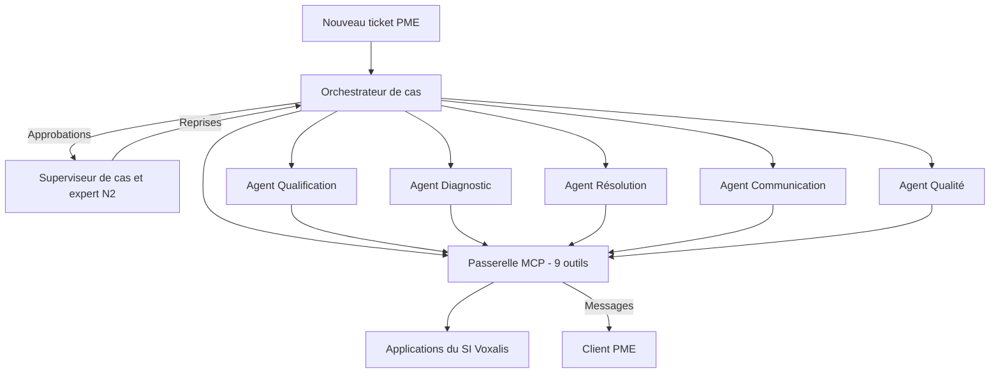

<!-- section: mode-emploi -->
## À quoi ça sert

Le dossier décrit le système comme un tout : qui fait quoi, qui parle à qui, où vit l'état, par où passent les écritures, comment on observe, déploie et arrête. Les [fiches agents](/templates/fiche-agent) décrivent chaque agent ; le dossier décrit ce qui les relie. C'est le support de l'approbation par la DSI, la sécurité et l'exploitation.

## Quand l'utiliser

Dès qu'un système atteint le barreau 5 de [l'échelle des solutions](/frameworks/faut-il-un-agent). Pour un agent seul, la fiche agent suffit. Version 1.0 au jalon G4, puis mise à jour à chaque [ADR](/templates/adr).

## Comment le remplir

1. Partir des exigences chiffrées : volumes, délais, disponibilité, coût par cas.
2. Dessiner la [topologie](/frameworks/topologies-multi-agents) la plus simple qui les tient, et dire pourquoi les autres sont écartées.
3. Fixer où vit l'état et qui a le droit de l'écrire.
4. Dresser la matrice outils par agents : un seul détenteur par outil d'écriture.
5. Faire relire sécurité, observabilité et déploiement par ceux qui opéreront.
6. Renvoyer chaque choix structurant à un ADR, chaque risque à l'[analyse de risques](/templates/analyse-risques-agent).

## Critères de qualité

- [ ] Chaque exigence non fonctionnelle est chiffrée et testable.
- [ ] Le diagramme tient en moins de quinze nœuds.
- [ ] L'état du cas a un propriétaire unique.
- [ ] Chaque outil d'écriture a un seul agent détenteur et une règle d'approbation.
- [ ] Le mode dégradé et l'arrêt d'urgence sont décrits et testables.
- [ ] Le coût par cas est estimé et rapproché du business case.
- [ ] L'équipe du client peut opérer le système décrit.

<!-- section: template -->
# Dossier d'architecture — _[Nom du système]_

| | |
| --- | --- |
| **Client / mission** | {{client}} — {{mission}} |
| **Domaine** | {{domaine}} |
| **Sponsor** | {{sponsor}} |
| **Version** | _[1.0]_ du {{date}} |
| **Rédacteurs** | {{auteur}} |
| **Approbateurs** | _[DSI, responsable Data & IA, RSSI, propriétaire du processus]_ |
| **Statut** | _[Projet / Approuvé le… / Réserves]_ |

## 1. Contexte et objectifs

_[Le problème métier en trois lignes, les objectifs chiffrés que le système doit servir, le périmètre de la première version.]_

| Indicateur | Référence | Cible | Échéance |
| --- | --- | --- | --- |
| | | | |

**Hors périmètre** : _[Ce que le système ne traite pas.]_

**Principes directeurs** : _[Trois à cinq règles qui tranchent les arbitrages : système de référence, barreau le plus bas, chemin unique des écritures, réversibilité.]_

## 2. Exigences

### 2.1 Exigences fonctionnelles

| N° | Le système doit | Source |
| --- | --- | --- |
| EF1 | _[Verbe + résultat observable]_ | _[Processus cible, atelier, réglementation]_ |

### 2.2 Exigences non fonctionnelles

| Catégorie | Exigence chiffrée | Comment elle se vérifie |
| --- | --- | --- |
| Volumétrie | _[Cas par jour, pointe horaire]_ | |
| Délais | | |
| Disponibilité et mode dégradé | | |
| Qualité | _[Renvoi aux seuils du plan d'évaluation]_ | |
| Sécurité et droits | | |
| Traçabilité | | |
| Données personnelles | | |
| Coût | _[Par cas]_ | |
| Réversibilité | | |
| Exploitabilité | | |

## 3. Topologie

_[Diagramme Mermaid `flowchart TD` de moins de quinze nœuds : l'entrée, l'orchestration, chaque agent, la passerelle, le SI, les humains, le destinataire final. Voir l'exemple.]_

**Topologie retenue** : _[Superviseur, pipeline, pairs, hiérarchique, et pourquoi.]_

**Topologies écartées** : _[Lesquelles, et la raison en une ligne chacune.]_

## 4. Agents

| Agent | Mission | Barreau et pattern | Autonomie | Outils | Fiche agent |
| --- | --- | --- | --- | --- | --- |
| | _[Une phrase]_ | _[2 appel unique, 3 workflow, 4 agent]_ | _[L1 à L5, par situation]_ | | _[Version]_ |

_[Pour chaque découpage en deux agents : la mesure qui le justifie, ou l'ADR qui la contient.]_

## 5. Orchestration et gestion de l'état

- **Qui tient le plan** : _[Code, modèle, ou les deux : préciser la part de chacun.]_
- **Objet d'état** : _[Ce qu'il contient, où il est stocké, qui peut l'écrire.]_

| État | Entrée dans l'état | Acteur | Sortie attendue | Délai maximal |
| --- | --- | --- | --- | --- |
| | | | | |

- **Règles d'aiguillage** : _[Conditions testables de chaque voie ou branche.]_
- **Passage de relais entre agents** : _[Contrats d'interface, schémas versionnés, contexte transmis.]_
- **Intervention humaine** : _[Approbation, correction, reprise : où, par qui, délai, que se passe-t-il sans réponse.]_
- **Erreurs et reprise** : _[Nouveaux essais, points de reprise, concurrence, priorité à l'humain.]_
- **Protocoles** : _[Agent vers outils, agent vers agent ; ce qui est retenu et pourquoi.]_

## 6. Outils et passerelle

| Outil | Application source | Nature | Risque | Règle d'approbation | Agents autorisés |
| --- | --- | --- | --- | --- | --- |
| _[domaine.action]_ | | _[Lecture / Écriture]_ | | | |

**Rôle de la passerelle** : _[Authentification, droits, validation des schémas, approbations, idempotence, limites, journalisation, mode simulation.]_

**Raccordement au SI** : _[API existantes, connecteurs à construire, déclenchement.]_

## 7. Données et connaissances

| Source | Usage par les agents | État de la donnée | Propriétaire | Action requise |
| --- | --- | --- | --- | --- |
| | | | | |

- **Mémoire** : _[Pendant le cas, entre les cas, jamais.]_
- **Boucle d'amélioration** : _[Comment les cas traités enrichissent évaluations et connaissances, et qui valide.]_

## 8. Sécurité

- **Identités** : _[Une par agent ; durée des jetons ; gestion des secrets.]_
- **Droits** : _[Matrice de la section 6 ; filtrage des données ; ce qu'aucun agent ne peut faire.]_
- **Entrées non fiables** : _[Lesquelles, comment elles sont isolées.]_
- **Arrêt d'urgence** : _[Granularité, qui peut le déclencher, délai, mode dégradé.]_

Détail des scénarios et des garde-fous : voir l'analyse de risques.

## 9. Observabilité

| Objet | Ce qui est observé | Outil ou format | Conservation |
| --- | --- | --- | --- |
| Traces | | | |
| Indicateurs | | | |
| Alertes | _[Peu nombreuses, chacune avec son action]_ | | |
| Audit | | | |

## 10. Déploiement

| Environnement | Usage | Outils | Données |
| --- | --- | --- | --- |
| | | _[Rejeu / Simulation / Réels]_ | |

- **Ce qui est versionné** : _[Prompts, descriptions d'outils, schémas, catalogue, jeux d'évaluation, configuration du modèle.]_
- **Chaîne de mise en production** : _[Étapes, portes d'évaluation, déploiement progressif.]_
- **Retour arrière** : _[Comment, en combien de temps.]_
- **Capacité** : _[Quotas, files d'attente, comportement en pointe.]_

## 11. Coûts

| Composant | Hypothèse | Coût par cas | Coût annuel |
| --- | --- | --- | --- |
| | | | |

**Rapprochement avec le business case** : _[Poste concerné, écart, leviers.]_

## 12. Décisions d'architecture

| ADR | Décision | Statut | Date | Signal de révision |
| --- | --- | --- | --- | --- |
| | | | | |

## 13. Risques et points ouverts

| Risque d'architecture | Impact | Parade | Porteur |
| --- | --- | --- | --- |
| | | | |

| Point ouvert | Décision attendue de | Échéance |
| --- | --- | --- |
| | | |

## Historique des versions

| Version | Date | Changement |
| --- | --- | --- |
| | | |

<!-- section: exemple -->
# Dossier d'architecture — SAV Augmenté

| | |
| --- | --- |
| **Client / mission** | Voxalis — Réinvention de l'Assistance & SAV Entreprises |
| **Domaine** | Assistance & SAV Entreprises |
| **Sponsor** | Claire Besson, Directrice générale adjointe Marché Entreprises |
| **Version** | 1.1 du 22 mai 2026 |
| **Rédacteurs** | Inès et Léo, FDE, avec l'architecte SI détaché |
| **Approbateurs** | Karim Haddad (DSI), Thomas Nguyen (Data & IA), Marc Dubois (RSSI), Sophie Lambert (propriétaire du processus) |
| **Statut** | Version 1.0 approuvée au COPIL de S17 (jalon G4), avec une réserve levée par ADR-004. Version 1.1 approuvée en revue d'architecture le 18 mai 2026 |

## 1. Contexte et objectifs

Voxalis met 31 heures en moyenne à résoudre un incident PME. Le diagnostic a montré que 41 % de ce délai est une attente entre N1 et N2 et 23 % une collecte manuelle d'informations dans six applications. SAV Augmenté reconstruit le flux en trois voies : autonome (35 % des tickets visés), assistée (45 %), experte (20 %).

| Indicateur | Référence | Cible | Échéance |
| --- | --- | --- | --- |
| MTTR | 31 h | 12 h | 18 mois |
| FCR | 54 % | 75 % | 18 mois |
| Coût par ticket | 41 € | 26 € | 18 mois |
| Résolution sans intervention humaine | 0 % | 35 % | 18 mois |

**Périmètre de la première version** : incidents techniques des clients PME, soit environ 260 000 tickets par an.

**Hors périmètre** : grands comptes, incidents de sécurité, demandes de modification, réclamations et facturation, toute action sur un équipement partagé entre plusieurs clients.

**Principes directeurs**

1. Le ticketing reste le système de référence. SAV Augmenté est une surcouche que l'on peut débrayer en moins de deux minutes.
2. Chaque composant est placé au barreau le plus bas qui suffit ; un découpage en agents se justifie par une mesure.
3. Toute écriture passe par la passerelle, qui tient les droits et les règles d'approbation. Le prompt explique, le code garantit.
4. Un seul agent détient chaque outil d'écriture.
5. Prompts, outils, catalogue et jeux d'évaluation sont versionnés ensemble et aucun changement n'est déployé sans évaluation.

## 2. Exigences

### 2.1 Exigences fonctionnelles

| N° | Le système doit | Source |
| --- | --- | --- |
| EF1 | Qualifier tout nouveau ticket d'incident PME : motif, service, urgence | Processus cible |
| EF2 | Produire pour chaque incident un diagnostic étayé par des preuves | Processus cible |
| EF3 | Orienter chaque cas vers la voie autonome, assistée ou experte selon des règles explicites | Processus cible |
| EF4 | Exécuter les remédiations du catalogue, avec approbation humaine quand la règle l'exige | Processus cible, Direction Réseau |
| EF5 | Informer le client à chaque étape, en signalant que le message est produit automatiquement | Processus cible, analyse de risques |
| EF6 | Permettre au superviseur de cas d'approuver, de corriger et de reprendre la main à tout moment | Atelier avec le plateau de Nantes |
| EF7 | Contrôler chaque cas clos et proposer des cas d'évaluation et des corrections d'articles | Modèle opérationnel cible |

### 2.2 Exigences non fonctionnelles

| Catégorie | Exigence chiffrée | Comment elle se vérifie |
| --- | --- | --- |
| Volumétrie | 1 000 incidents par jour ouvré en moyenne ; pointe de 250 cas par heure lors d'un incident collectif | Test de charge en préproduction |
| Délais | Qualification en moins de 30 secondes ; diagnostic en moins de 3 minutes au 95e centile ; premier message au client moins de 5 minutes après l'ouverture | Traces |
| Disponibilité et mode dégradé | 99,5 % sur la plage de service du SAV ; bascule en voie assistée sans agents en moins de 2 minutes | Exercice de bascule avant le pilote, puis chaque trimestre |
| Qualité | Les quatre seuils du plan d'évaluation | Golden set et jeu adverse, à chaque modification et chaque nuit |
| Sécurité et droits | Moindre privilège par agent ; aucune écriture hors passerelle | Revue de la matrice de droits ; tests de la table de décision |
| Traçabilité | Une trace complète par cas, conservée 13 mois | Contrôle par échantillon |
| Données personnelles | Identité du contact et adresse du site masquées dans les journaux ; traitements hébergés dans l'Union européenne ; aucune réutilisation pour l'entraînement | Test de masquage ; clauses contractuelles |
| Coût | 0,50 € d'inférence par ticket au plus, en moyenne | Suivi par agent et par voie |
| Réversibilité | Changement de modèle sans réécriture des agents, jugé sur le golden set ; standards ouverts pour les outils et les traces | Essai sur un second modèle pendant le prototype |
| Exploitabilité | Système opérable par une équipe AgentOps de 3 ETP | Transfert vérifié au jalon G6 |

## 3. Topologie

**Topologie retenue** : superviseur. L'Orchestrateur de cas tient l'état et appelle les agents ; les agents ne se parlent pas entre eux. Chaque cas a ainsi un seul fil, une seule trace et un seul responsable de l'état.

**Topologies écartées**

- Pipeline fixe : un cas sur cinq sort du chemin nominal (voie experte), et les attentes d'approbation, les reprises et les réouvertures imposent des retours en arrière.
- Agents pairs qui se délèguent librement : état dispersé, trace difficile à lire, responsabilité floue en cas d'incident.
- Agent unique : mesuré au début du prototype, sous le seuil de qualité et incompatible avec la séparation des droits (ADR-004).

## 4. Agents

| Agent | Mission | Barreau et pattern | Autonomie | Outils | Fiche agent |
| --- | --- | --- | --- | --- | --- |
| Orchestrateur de cas | Tenir l'état du cas, choisir la voie, déclencher les escalades | 3 pour les transitions, tenues par le code ; modèle sollicité pour les exceptions | L3 | `crm.lire_ticket`, `crm.mettre_a_jour_ticket` | 1.1 |
| Agent Qualification | Classer le ticket, extraire les informations, enrichir depuis le CRM | 2 : appel de modèle unique à sortie structurée | L4, contrôle par échantillonnage | `crm.lire_ticket` | 1.0 |
| Agent Diagnostic | Établir la cause, preuves à l'appui | 4 : agent | L3, lecture seule | `supervision.etat_service`, `ligne.lancer_test`, `inventaire.lire_parc`, `incidents.rechercher_connus`, `kb.rechercher` | 1.2 |
| Agent Résolution | Exécuter les actions du catalogue de remédiation et vérifier le rétablissement | 4 : agent, sur un catalogue fermé de 10 actions | L3 sur le catalogue à risque faible, L2 au-delà | `reseau.executer_action`, `supervision.etat_service`, `ligne.lancer_test`, `kb.rechercher` | 1.1 |
| Agent Communication | Informer le client à chaque étape | 3 : workflow (lire l'état, choisir le gabarit, rédiger, contrôler, envoyer) | L3 pour les messages de statut, L2 pour tout geste commercial | `client.envoyer_message` | 1.0 |
| Agent Qualité | Contrôler chaque cas clos, alimenter les évaluations et la base de connaissances | 3 : workflow d'évaluation avec grille | L3 | `crm.lire_ticket`, `kb.rechercher` | 1.0 |

Le système compte six composants, dont deux seulement sont des agents au sens strict. Le nom « agent » est conservé pour tous par cohérence avec le modèle opérationnel.

La séparation entre Diagnostic et Résolution repose sur une mesure : un agent unique portant les neuf outils et les règles de remédiation voit la justesse du diagnostic passer de 91 % à 84 % (ADR-004). Aucun autre découpage ne sera fait sans mesure équivalente.

L'Agent Qualité n'écrit pas dans la base de connaissances : il dépose des propositions dans une file de revue, et un expert publie.

## 5. Orchestration et gestion de l'état

**Qui tient le plan** : le code. L'Orchestrateur est une machine à états explicite. Le modèle n'y intervient que pour rédiger la synthèse du dossier destinée à l'humain et pour choisir la reprise quand un agent échoue, dans la limite de deux tentatives.

**Objet d'état** : le « cas », rattaché à un ticket. Il contient le ticket qualifié, le diagnostic, les actions demandées et leurs résultats, les messages envoyés, les approbations et l'état courant. Il est stocké dans un magasin transactionnel, sous forme de journal d'événements en ajout seul. Seul l'Orchestrateur l'écrit.

| État | Entrée dans l'état | Acteur | Sortie attendue | Délai maximal |
| --- | --- | --- | --- | --- |
| Reçu | Nouveau ticket détecté | Orchestrateur | Appel de la qualification | 30 s |
| Qualifié | Sortie `qualification.v1` valide | Agent Qualification | Incident technique : diagnostic. Sinon : hors périmètre, retour au flux habituel | 30 s |
| Diagnostiqué | Sortie `diagnostic.v1` valide | Agent Diagnostic | Choix de la voie | 5 min |
| En attente d'approbation | Règle d'approbation déclenchée | Superviseur de cas ou expert N2 | Accord, refus ou reprise en main | 15 min, puis réaffectation au responsable de plateau |
| En résolution | Voie autonome, ou accord humain | Agent Résolution | Action exécutée et vérifiée | 5 min |
| Rétabli | Vérification positive | Orchestrateur | Message de rétablissement, demande de confirmation au client | — |
| Escaladé | Confiance faible, échec, demande d'un agent | Expert N2 | Cas mené par l'expert, agents à la demande | Selon l'urgence |
| Clos | Confirmation du client, ou 48 h sans retour | Orchestrateur | Contrôle par l'Agent Qualité | — |

**Règles d'aiguillage**, appliquées par le code après le diagnostic :

- Voie autonome : motif ouvert à l'autonomie, diagnostic à confiance élevée, remédiation au catalogue à risque faible, aucune règle d'approbation déclenchée par la passerelle.
- Voie experte : confiance faible, escalade demandée par un agent, suspicion d'incident de sécurité, troisième réouverture.
- Voie assistée : tous les autres cas.

**Passage de relais entre agents** : chaque agent reçoit de l'Orchestrateur un contexte minimal, construit pour lui, jamais l'historique brut. Les contrats sont des schémas versionnés : `qualification.v1`, `diagnostic.v1`, `resolution.v1`, `message.v1`. Une sortie non conforme donne lieu à un nouvel essai, puis à une escalade. L'Agent Résolution ne reçoit pas le texte libre du client.

**Intervention humaine** : les demandes d'approbation arrivent dans le poste de supervision avec le diagnostic et ses preuves. Aucune demande n'est approuvée par défaut. Toute action d'un conseiller sur le ticket suspend les agents sur ce cas : l'humain prime.

**Erreurs et reprise** : un point de reprise à chaque transition ; un seul cas actif par ticket ; une action dont l'issue est inconnue n'est jamais rejouée sans relecture de l'état du service.

**Détection des tickets** : faute de bus d'événements, l'Orchestrateur interroge le ticketing toutes les 30 secondes (ADR-007).

**Protocoles** : MCP entre les agents et les outils. Pas de protocole entre agents dans cette version : tous tournent dans le même environnement et sont opérés par la même équipe (ADR-008).

## 6. Outils et passerelle

| Outil | Application source | Nature | Risque | Règle d'approbation | Agents autorisés |
| --- | --- | --- | --- | --- | --- |
| `crm.lire_ticket` | CRM et ticketing | Lecture | Faible | Aucune | Orchestrateur, Qualification, Qualité |
| `crm.mettre_a_jour_ticket` | CRM et ticketing | Écriture | Moyen | Aucune pour le statut, la voie et les notes ; clôture sans humain en voie autonome seulement | Orchestrateur |
| `supervision.etat_service` | Supervision réseau | Lecture | Faible | Aucune | Diagnostic, Résolution |
| `ligne.lancer_test` | Test de ligne | Lecture, avec micro-coupure possible | Moyen | Aucune hors heures ouvrées du client, sinon humaine | Diagnostic, Résolution |
| `inventaire.lire_parc` | Inventaire du parc | Lecture | Faible | Aucune | Diagnostic |
| `incidents.rechercher_connus` | Supervision réseau | Lecture | Faible | Aucune | Diagnostic |
| `reseau.executer_action` | Supervision réseau | Écriture | Faible à élevé selon l'action | Table de décision à 11 règles : 6 actions à risque faible sans approbation sous conditions, 4 toujours soumises à approbation | Résolution |
| `kb.rechercher` | Base de connaissances | Lecture | Faible | Aucune | Diagnostic, Résolution, Qualité |
| `client.envoyer_message` | CRM et ticketing, canaux e-mail et SMS | Écriture | Moyen | Aucune pour un message de statut sur gabarit ; humaine pour tout geste commercial | Communication |

Neuf outils, dont trois en écriture, chacun détenu par un seul agent. Chaque outil a sa spécification d'outil.

**Rôle de la passerelle** : point de passage unique vers le SI (ADR-001). Elle authentifie l'agent appelant, vérifie ses droits, valide les paramètres, filtre les données sur le client du ticket, applique les règles d'approbation et les limites de débit, calcule les clés d'idempotence, journalise chaque appel. Elle offre un mode simulation pour les écritures et un mode rejeu pour les lectures, utilisés par les évaluations et par le mode fantôme.

**Raccordement au SI** : quatre des six applications exposent une API ; pour les autres, un connecteur dédié masque la différence. La base de connaissances est servie par un index de recherche reconstruit chaque nuit. La facturation n'est pas raccordée dans cette version.

## 7. Données et connaissances

| Source | Usage par les agents | État de la donnée | Propriétaire | Action requise |
| --- | --- | --- | --- | --- |
| Base de connaissances | Procédures de diagnostic et de remédiation | 2 300 articles, dont 35 % obsolètes | Sophie Lambert | Index limité aux articles validés depuis moins de 12 mois ; revue des articles des 12 motifs avant le pilote |
| Inventaire du parc | Services, équipements, offres | Retards de mise à jour après remplacement d'équipement | Karim Haddad | La supervision prime en cas de contradiction ; écarts remontés à la DSI |
| Supervision réseau | État, alarmes, incidents collectifs | Fiable ; tenue en charge vérifiée par le test du 3 avril | Direction Réseau | Quota d'appels réservé à la passerelle |
| Catalogue de remédiation | 10 actions, leurs effets et leur niveau de risque | Créé pour le projet, version 1.0 | Direction Réseau | Toute évolution passe par le comité de gouvernance IA |
| Référentiel des causes | 23 codes de cause | Créé pour le projet avec les experts N2 | Sophie Lambert | Revue trimestrielle |
| Golden set et jeu adverse | 600 cas annotés, 120 cas adverses | Version 1.0 gelée le 17 avril 2026 | Thomas Nguyen | Enrichissement continu par les cas de production |

**Mémoire** : pendant le cas, tout est dans l'objet d'état. Entre les cas, aucune mémoire d'agent (ADR-006) : un agent ne se souvient ni d'un client ni d'un cas précédent.

**Boucle d'amélioration** : l'Agent Qualité contrôle chaque cas clos et dépose ses propositions (cas à ajouter au golden set, article à créer ou à corriger) dans une file de revue. Les experts N2 valident. Le système s'améliore par ses évaluations et ses connaissances, pas par une mémoire implicite.

## 8. Sécurité

- **Identités** : une identité technique par agent, six au total. Jetons de 15 minutes délivrés par le service d'identité de la DSI. Aucun secret dans les prompts ni dans le contexte des modèles.
- **Droits** : la matrice de la section 6 est appliquée par la passerelle. Les applications sources n'acceptent que la passerelle. Aucun agent ne peut agir sur un équipement partagé ni sur un client autre que celui du ticket.
- **Entrées non fiables** : la description du ticket et tout texte renvoyé par un outil sont balisés et présentés comme des données. L'agent exposé au texte du client n'a aucun outil d'écriture réseau.
- **Approbations** : signées par l'identité de l'approbateur et conservées avec le cas.
- **Arrêt d'urgence** : trois interrupteurs, par agent, par motif et par outil d'écriture, plus un disjoncteur automatique par zone. Déclenchement par l'équipe d'exploitation ou par la responsable de plateau, effet en moins de 2 minutes, bascule en voie assistée.

Détail des quatorze scénarios et de leurs garde-fous : voir l'analyse de risques, version 1.0 du 5 mai 2026.

## 9. Observabilité

| Objet | Ce qui est observé | Outil ou format | Conservation |
| --- | --- | --- | --- |
| Traces | Une trace par cas : transitions, appels de modèle, appels d'outils, sorties, versions, coût | Format OpenTelemetry, corrélation par identifiant de ticket | 13 mois, données personnelles masquées |
| Indicateurs de qualité | Justesse hebdomadaire sur échantillon, taux d'escalade, diagnostics corrigés par les conseillers, score nocturne sur le golden set | Tableau de bord d'exploitation | 3 ans |
| Indicateurs de flux et de coût | Volume par voie, délais par état, coût par ticket, par agent et par voie | Tableau de bord d'exploitation | 3 ans |
| Alertes | Justesse hebdomadaire sous 88 % ; plus de 5 diagnostics identiques sur une zone en 30 minutes ; baisse du score nocturne ; coût moyen par ticket au-dessus de 0,50 € ; file d'approbation de plus de 15 minutes | Astreinte de l'équipe d'exploitation | — |
| Audit | Chaque appel d'écriture, avec la règle appliquée et l'approbateur | Journal de la passerelle, en ajout seul | 13 mois |

Chaque alerte a son entrée dans le runbook : diagnostic, action immédiate, mode dégradé, personnes à prévenir.

## 10. Déploiement

| Environnement | Usage | Outils | Données |
| --- | --- | --- | --- |
| Développement | Mise au point des prompts et des outils | Lectures en rejeu, écritures simulées | Golden set pseudonymisé |
| Préproduction | Évaluations complètes, tests de charge, exercices d'arrêt | Lectures réelles sur lignes de test, écritures simulées ou sur lignes de test | Lignes de test de la Direction Réseau |
| Production | Mode fantôme, puis service | Réels, selon le palier d'autonomie | Réelles |

- **Ce qui est versionné** : prompts, descriptions d'outils, schémas, catalogue de remédiation, table de décision, gabarits de messages, jeux d'évaluation, version du modèle. Le tout dans un même dépôt.
- **Chaîne de mise en production** : tests de contrat, golden set et jeu adverse complets, revue par un pair, préproduction, puis production par paliers : fantôme, 10 % des tickets, 50 %, 100 %.
- **Retour arrière** : en une commande, vers la version précédente de l'ensemble ; vérifié à chaque livraison.
- **Capacité** : file d'attente par agent ; au-delà de la pointe dimensionnée, les cas basculent en voie assistée plutôt que d'attendre.

## 11. Coûts

Plafonds de conception, à confirmer par le pilote.

| Composant | Hypothèse | Coût d'inférence par ticket |
| --- | --- | --- |
| Orchestrateur de cas | Synthèse du dossier, reprises | 0,06 € |
| Agent Qualification | Un appel, modèle léger | 0,04 € |
| Agent Diagnostic | 5 à 6 appels d'outils en moyenne | 0,20 € |
| Agent Résolution | Sollicité sur une partie des tickets | 0,08 € |
| Agent Communication | 2 à 3 messages par ticket, modèle léger | 0,06 € |
| Agent Qualité | Un contrôle par cas clos | 0,06 € |
| **Total** | | **0,50 €** |

**Rapprochement avec le business case** : 0,50 € sur 420 000 tickets donne 0,21 M€ par an au plafond. Avec 0,34 M€ de plateforme (hébergement, passerelle, observabilité, évaluations), le total reste dans le poste « inférence et plateforme » de 0,55 M€.

**Leviers** : modèles légers pour les tâches simples, mise en cache des instructions stables, contexte minimal par agent, plafonds par cas. Un passage complet des évaluations coûte de l'ordre de 300 € : c'est un poste à suivre, pas à supprimer.

## 12. Décisions d'architecture

| ADR | Décision | Statut | Date | Signal de révision |
| --- | --- | --- | --- | --- |
| ADR-001 | Passerelle MCP unique pour tous les accès au SI | Accepté | 14 avril 2026 | Latence ajoutée supérieure à 500 ms au 95e centile |
| ADR-002 | Qualification par appel de modèle unique, sans agent | Accepté | 16 avril 2026 | Exactitude sous 95 % malgré deux itérations |
| ADR-003 | Communication en workflow à gabarits | Accepté | 21 avril 2026 | Plus de 10 % de messages hors gabarit demandés par le métier |
| ADR-004 | Séparer l'Agent Diagnostic de l'Agent Résolution | Accepté, après mesure sur le prototype | 18 mai 2026 | Un agent unique atteint 90 % de justesse avec les neuf outils |
| ADR-005 | Orchestration par machine à états ; état du cas écrit par le seul Orchestrateur | Accepté | 30 avril 2026 | Plus de 15 % de cas traités par la reprise sur exception |
| ADR-006 | Aucune mémoire d'agent entre les cas | Accepté | 30 avril 2026 | Besoin métier établi de suivre un client d'un cas à l'autre |
| ADR-007 | Détection des tickets par interrogation périodique, faute de bus d'événements | Accepté | 5 mai 2026 | Mise en service d'un bus d'événements par la DSI |
| ADR-008 | Pas de protocole entre agents dans la première version | Accepté | 5 mai 2026 | Intégration d'un agent opéré par une autre équipe ou un tiers |

## 13. Risques et points ouverts

| Risque d'architecture | Impact | Parade | Porteur |
| --- | --- | --- | --- |
| Dépendance à la supervision réseau, appelée par trois outils | Sans elle, ni diagnostic ni action | Bascule en voie assistée ; quota réservé ; test de charge refait avant chaque vague | Karim Haddad |
| Base de connaissances insuffisante hors des 12 motifs | Diagnostics à confiance faible sur la longue traîne | Voie assistée par défaut ; propositions d'articles par l'Agent Qualité | Sophie Lambert |
| Interrogation périodique du ticketing | Jusqu'à 30 secondes de délai, charge sur le ticketing | Acceptée ; ADR-007 | Karim Haddad |
| Dépendance au fournisseur du modèle | Changement de version, de prix ou de disponibilité | Version figée, golden set comme critère de bascule, second modèle testé | Thomas Nguyen |
| Compétences d'exploitation à constituer | Système approuvé mais non opérable | Équipe AgentOps nommée pendant le pilote ; transfert engagé dès le prototype | Thomas Nguyen |

| Point ouvert | Décision attendue de | Échéance |
| --- | --- | --- |
| Liste des motifs ouverts à la voie autonome au début du pilote | Sophie Lambert, Direction Réseau | S21 |
| Conduite pour les entrepreneurs individuels au regard de la décision automatisée | Élise Martin, direction juridique | S20 |
| Raccordement de la facturation pour les réclamations | COPIL | Après la généralisation |

## Historique des versions

| Version | Date | Changement |
| --- | --- | --- |
| 0.1 | 17 avril 2026 | Exigences, premiers ADR, liste des outils |
| 1.0 | 6 mai 2026 | Version approuvée au jalon G4. Réserve : prouver par la mesure qu'un agent unique ne suffit pas pour le diagnostic et la résolution |
| 1.1 | 22 mai 2026 | Réserve levée par ADR-004 ; schéma `diagnostic.v1` ; deux identités distinctes pour Diagnostic et Résolution |
