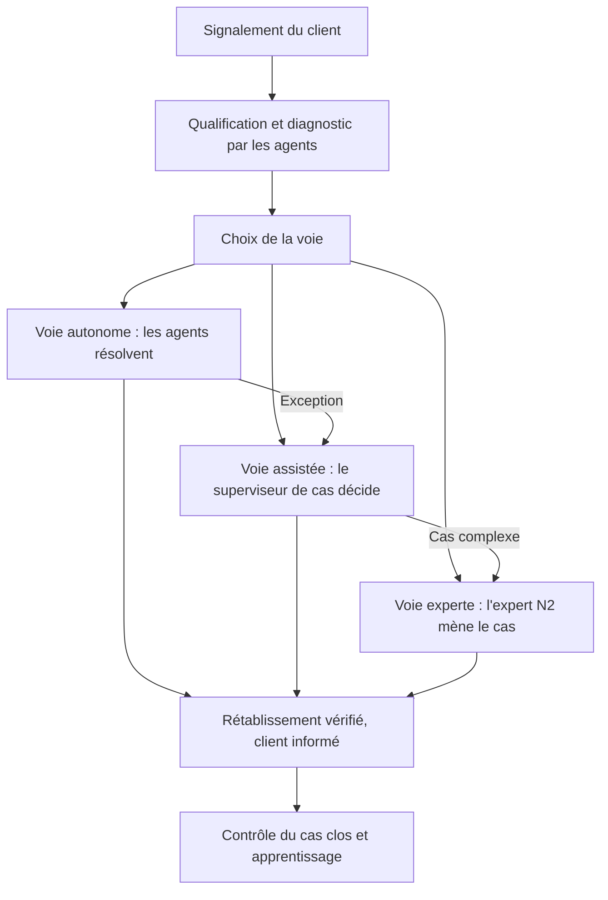

<!-- section: mode-emploi -->
## À quoi ça sert

Ce document décrit le processus tel qu'il fonctionnera, pas tel qu'il sera construit. Il fixe ce que le métier valide avant toute conception technique : le résultat dû au client, les voies de traitement, qui fait quoi et avec quelle autonomie, et le chemin pour y arriver. La phase Concevoir en déduit les agents ; l'inverse ne fonctionne pas.

## Quand l'utiliser

En phase [Réinventer](/methode/reinventer), à partir de la [fiche du processus existant](/templates/fiche-processus-existant). Il passe le jalon G3 avec la [matrice humain-agent](/templates/matrice-humain-agent) et le [modèle opérationnel cible](/templates/modele-operationnel-cible). La démarche est décrite dans [Repenser un processus](/guides/repenser-un-processus) ; l'outil [Redesign de processus](/outils/redesign-processus) tient la comparaison avant-après.

## Comment le remplir

1. Écrire le résultat du point de vue de celui qui le reçoit, cartographie fermée.
2. Définir les voies par le risque et la prévisibilité des cas, avec un critère d'entrée testable et une part de volume tirée des données.
3. Décrire les étapes par fonction (« agent de diagnostic »), sans figer l'architecture.
4. Compter : étapes, passages de relais, délais par poste. Si la cible n'en supprime pas, recommencer.
5. Rejouer vingt à trente cas réels avec des opérationnels, corriger, puis faire valider.

## Critères de qualité

- [ ] Le résultat tient en une phrase et ne parle ni de ticket ni d'outil.
- [ ] Chaque voie a un critère d'entrée testable, une part du volume et une règle de bascule.
- [ ] Chaque étape nomme son exécutant et son niveau d'autonomie.
- [ ] Les étapes, relais et délais supprimés sont chiffrés.
- [ ] Les exceptions ont un traitement, mode dégradé compris.
- [ ] Des cas réels ont été rejoués ; les corrections sont tracées.

<!-- section: template -->
# Processus cible AI-Native — {{client}} — {{domaine}}

| | |
| --- | --- |
| **Mission** | {{mission}} |
| **Sponsor** | {{sponsor}} |
| **Propriétaire du processus** | _[Nom, fonction]_ |
| **Version** | _[0.1]_ du {{date}} |
| **Rédacteur** | {{auteur}} |
| **Validation** | _[Instance, date]_ |

## 1. Résultat visé

**Résultat, du point de vue du client** : _[Une phrase. Exemple : « un client rétabli et informé ».]_

**Périmètre** : _[Événement qui ouvre le processus, événement qui le clôt, cas exclus]_

**Ce que le résultat change par rapport à l'existant** : _[Ce que l'on cesse d'optimiser]_

## 2. Principes de conception

| Principe | Application au processus |
| --- | --- |
| Flux déclenchés par événements | _[Ce qui lance le traitement sans attendre une file]_ |
| Traitements parallèles | _[Ce qui s'exécute en même temps]_ |
| L'humain sur l'exception et la décision | _[Ce qui reste humain, et pourquoi]_ |
| Voies différenciées selon le risque | _[Critère de différenciation]_ |
| Boucle d'apprentissage intégrée | _[Ce que chaque cas clos alimente]_ |

**Contraintes réelles conservées** : _[Obligations réglementaires, contractuelles, physiques. Citer le texte ou l'engagement.]_

## 3. Flux cible

_[Un diagramme simple, moins de 15 nœuds : déclencheur, qualification, choix de la voie, voies, bascules, résultat. Squelette à placer dans un bloc `mermaid` et à adapter.]_

```text
flowchart TD
  E["Événement déclencheur"] --> Q["Qualification et analyse"]
  Q --> V["Choix de la voie"]
  V --> A["Voie 1"]
  V --> B["Voie 2"]
  V --> C["Voie 3"]
  A -->|Exception| B
  B -->|Cas complexe| C
  A --> R["Résultat visé"]
  B --> R
  C --> R
```

## 4. Voies

| Voie | Critère d'entrée | Part du volume | Mode de collaboration | Règle de bascule | Délai cible |
| --- | --- | --- | --- | --- | --- |
| _[Nom]_ | _[Règle testable sur le cas]_ | _[%, source]_ | _[Contrôle a posteriori / Approbation / Délégation par l'expert]_ | _[Ce qui fait passer à la voie supérieure]_ | |

## 5. Étapes cibles

| N° | Étape | Qui réalise | Niveau d'autonomie | Outils ou applications | Ce qui sort de l'étape |
| --- | --- | --- | --- | --- | --- |
| 1 | | _[Agent de… / Rôle humain]_ | _[L0 à L5]_ | | |

## 6. Comparaison avant / après

| | Existant | Cible | Écart |
| --- | --- | --- | --- |
| Nombre d'étapes | | | |
| Passages de relais entre personnes | | | |
| Outils manipulés par l'opérateur | | | |
| Délai de bout en bout | | | |

**Délai par poste**

| Poste | Existant | Cible | Ce qui explique l'écart |
| --- | --- | --- | --- |
| Attente interne | | | |
| Collecte d'informations | | | |
| Attente externe | | | |
| Traitement effectif | | | |

## 7. Indicateurs cibles

| Indicateur | Référence | Cible | Échéance | Source |
| --- | --- | --- | --- | --- |
| | | | | |

## 8. Exceptions

| Situation | Détection | Traitement | Voie |
| --- | --- | --- | --- |
| | | | |

**Mode dégradé** : _[Ce qui se passe si les agents sont arrêtés ou indisponibles]_

## 9. Prérequis

| Prérequis | Responsable | Échéance | État |
| --- | --- | --- | --- |
| _[Données, accès, règles, accord social, formation]_ | | | |

## 10. Trajectoire de transition

| Palier | Période | Ce qui est ouvert | Condition de passage au palier suivant |
| --- | --- | --- | --- |
| | | | |

## 11. Mise à l'épreuve et validation

**Cas réels rejoués** : _[Nombre, participants, date]_

| Constat du rejeu | Correction apportée à la cible |
| --- | --- |
| | |

| Validé par | Fonction | Date |
| --- | --- | --- |
| | | |

<!-- section: exemple -->
# Processus cible AI-Native — Voxalis — Assistance & SAV Entreprises

| | |
| --- | --- |
| **Mission** | Réinvention de l'Assistance & SAV Entreprises |
| **Sponsor** | Claire Besson, Directrice générale adjointe Marché Entreprises |
| **Propriétaire du processus** | Sophie Lambert, Directrice Relation Client Entreprises |
| **Version** | 1.0 du 7 avril 2026 |
| **Rédacteur** | Hugo, FDE, avec les deux experts N2 détachés et le product owner |
| **Validation** | COPIL du 9 avril 2026 (jalon G3) |

## 1. Résultat visé

**Résultat, du point de vue du client** : un client rétabli et informé.

**Périmètre** : du signalement d'un incident technique par un client PME à la confirmation du rétablissement. Hors périmètre : grands comptes, demandes de modification, réclamations et facturation, réalisation des interventions sur site.

**Ce que le résultat change par rapport à l'existant** : le processus actuel produit des tickets clos. Il optimise le passage d'un niveau à l'autre, pas le rétablissement. La cible ne conserve ni les niveaux N1 et N2 comme étapes, ni la file d'attente entre eux, qui représente 41 % du délai.

## 2. Principes de conception

| Principe | Application au processus |
| --- | --- |
| Flux déclenchés par événements | Le signalement lance aussitôt qualification et diagnostic. Plus aucun ticket n'attend d'être pris dans une file |
| Traitements parallèles | Supervision, test de ligne, inventaire et incidents connus sont interrogés en même temps, et non l'un après l'autre par un conseiller |
| L'humain sur l'exception et la décision | Le conseiller, devenu superviseur de cas, décide sur proposition, reprend les exceptions et porte la relation. L'expert N2 mène les cas inédits |
| Voies différenciées selon le risque | Trois voies : autonome, assistée, experte. La voie dépend du motif, de la confiance du diagnostic et du risque de l'action |
| Boucle d'apprentissage intégrée | Chaque cas clos est contrôlé ; les écarts alimentent les cas d'évaluation et la base de connaissances |
| Une personne joignable à tout moment | Principe propre à Voxalis : un client qui demande un interlocuteur l'obtient, avec le dossier déjà constitué |

**Contraintes réelles conservées** : toute action sur un équipement partagé entre plusieurs clients reste réservée à la Direction Réseau. Tout geste commercial est décidé par une personne. Les données d'identité du contact sont masquées dans les traces, selon les règles fixées avec Élise Martin (DPO).

## 3. Flux cible



Le client est informé à chaque changement d'état, quelle que soit la voie.

## 4. Voies

| Voie | Critère d'entrée | Part du volume | Mode de collaboration | Règle de bascule | Délai cible |
| --- | --- | --- | --- | --- | --- |
| Autonome | Motif ouvert à la voie autonome, diagnostic à confiance élevée, remédiation à risque faible (réversible, limitée au service du client, interruption brève), aucun incident collectif sur la zone, aucune réclamation ouverte | 35 % | Contrôle a posteriori par échantillonnage | Service non rétabli après l'action, ou critère d'entrée non tenu en cours de route : voie assistée | 1,5 h |
| Assistée | Diagnostic conclu, mais un critère de la voie autonome manque : motif non ouvert, confiance moyenne, action à risque moyen | 45 % | Approbation : les agents qualifient, diagnostiquent et proposent, le superviseur de cas décide | Diagnostic à confiance faible, récidive, action à risque élevé : voie experte | 10 h |
| Experte | Motif inédit, diagnostic à confiance faible, troisième incident en 30 jours sur le même service, client multi-sites, intervention sur site | 20 % | Délégation : l'expert N2 mène le cas, les agents préparent le dossier et exécutent à sa demande | Sans objet | 35 h |

Les parts viennent des données du diagnostic. Douze motifs récurrents à la résolution documentée concentrent 58 % des incidents ; la voie autonome en prend environ six sur dix, ceux dont la remédiation est à risque faible. La voie est pressentie à la qualification et confirmée après le diagnostic.

## 5. Étapes cibles

Les rôles d'agent décrivent des fonctions. Le découpage en agents sera arrêté en phase Concevoir.

| N° | Étape | Qui réalise | Niveau d'autonomie | Outils ou applications | Ce qui sort de l'étape |
| --- | --- | --- | --- | --- | --- |
| 1 | Prise en charge et qualification | Agent de qualification | L4, contrôle par échantillonnage | CRM et ticketing | Ticket classé, informations extraites, client et service identifiés |
| 2 | Diagnostic | Agent de diagnostic | L3, lecture seule. Test de ligne soumis à approbation pendant les heures ouvrées du client | Supervision réseau, test de ligne, inventaire du parc, base de connaissances | Cause probable, preuves, niveau de confiance, remédiation recommandée |
| 3 | Choix de la voie et suivi du cas | Orchestration du cas | L3 | Règles d'entrée des voies | Voie affectée ; un seul état du cas, visible de tous |
| 4a | Résolution, voie autonome | Agent de résolution | L3 sur le catalogue d'actions à risque faible | Supervision réseau | Action exécutée et tracée |
| 4b | Résolution, voie assistée | Le superviseur de cas décide ; l'agent de résolution prépare, puis exécute | L2 | Poste de supervision | Décision tracée : approuvée, modifiée ou refusée avec motif |
| 4c | Résolution, voie experte | L'expert N2 mène ; les agents exécutent à sa demande | L1 pour l'assistance, L2 pour les actions | Poste de supervision | Cas résolu, ou intervention sur site demandée au back-office |
| 5 | Vérification et clôture | Orchestration du cas en voie autonome ; superviseur de cas ou expert sinon | L3 | Supervision réseau, CRM et ticketing | Service vérifié « rétabli » ; clôture confirmée au client |
| 6 | Contrôle et apprentissage | Agent de contrôle qualité ; les experts N2 valident | L3 pour le contrôle, L2 pour toute publication dans la base de connaissances | Base de connaissances, cas d'évaluation | Écarts signalés, cas ajoutés aux évaluations, articles proposés |
| En continu | Information du client | Agent de communication | L3 pour les messages de statut, L2 pour tout geste commercial | CRM et ticketing, canaux de message | Client informé à chaque changement d'état |

## 6. Comparaison avant / après

| | Existant | Cible | Écart |
| --- | --- | --- | --- |
| Nombre d'étapes | 9 | 6, plus l'information du client en continu | −3 |
| Passages de relais entre personnes | 4 | Aucun en voies autonome et assistée, 1 au plus en voie experte | −3 à −4 |
| Outils manipulés par le conseiller | 6 | 1 poste de supervision | −5 |
| Organisation du flux | Trois niveaux en file : N1, N2, back-office | Trois voies selon le risque | — |
| Délai moyen de résolution | 31 h | 12 h | −61 % |

**Délai par poste**

| Poste | Existant | Cible | Ce qui explique l'écart |
| --- | --- | --- | --- |
| Attente entre niveaux | 12,7 h | 3,0 h | Plus de file entre N1 et N2 ; reste l'attente d'un expert en voie experte et d'une approbation en voie assistée |
| Collecte et diagnostic | 7,1 h | 0,5 h | Diagnostic produit en quelques minutes ; temps de lecture et de décision du superviseur |
| Attente client | 5,6 h | 4,0 h | Client informé sans avoir à rappeler ; moins de demandes de précisions |
| Traitement effectif | 5,6 h | 4,5 h | Actions à risque faible exécutées sans délai ; les interventions sur site ne changent pas |
| **Total** | **31,0 h** | **12,0 h** | |

**Délai par voie**, estimé en réaffectant les 12 mois de tickets aux voies cibles

| Voie | Part | Délai actuel des mêmes cas | Délai cible |
| --- | --- | --- | --- |
| Autonome | 35 % | 16 h | 1,5 h |
| Assistée | 45 % | 28 h | 10 h |
| Experte | 20 % | 64 h | 35 h |
| **Ensemble** | 100 % | **31 h** | **12 h** |

## 7. Indicateurs cibles

| Indicateur | Référence | Cible | Échéance | Source |
| --- | --- | --- | --- | --- |
| Délai moyen de résolution (MTTR) | 31 h | 12 h | 18 mois | Ticketing |
| Résolution au premier contact (FCR) | 54 % | 75 % | 18 mois | Ticketing |
| Taux de réouverture (garde-fou) | 14 % | 7 % | 18 mois | Ticketing |
| Résolution sans intervention humaine | 0 % | 35 % | 18 mois | Traces du système |
| Coût par ticket | 41 € | 26 € | 18 mois | Contrôle de gestion |
| NPS Entreprises | +8 | +30 | 18 mois | Baromètre clients |
| Propositions acceptées sans correction en voie assistée | Sans objet | Au moins 85 % | Dès le pilote | Poste de supervision |

## 8. Exceptions

| Situation | Détection | Traitement | Voie |
| --- | --- | --- | --- |
| Incident collectif sur une zone | Incident déclaré par la Direction Réseau, ou plusieurs diagnostics identiques sur une zone en peu de temps | Aucune action individuelle ; tickets rattachés à l'incident, clients informés, Direction Réseau alertée | Hors voies |
| Client qui demande une personne | Demande explicite, à tout moment | Transfert immédiat au superviseur de cas, avec le dossier | Assistée |
| Récidive | Troisième incident en 30 jours sur le même service | Reprise par un expert N2, recherche de la cause de fond | Experte |
| Suspicion d'incident de sécurité | Signes relevés au diagnostic | Arrêt du traitement automatique, expert N2, alerte à l'équipe de Marc Dubois | Experte |
| Application source indisponible | Erreur ou délai dépassé | Diagnostic à confiance faible, reprise manuelle par le superviseur | Assistée |
| Intervention sur site nécessaire | Équipement injoignable ou défaut physique | Demande au back-office ; client informé du créneau | Experte |
| Réclamation ouverte ou client mécontent | Réclamation au dossier, ton du message | Aucun message automatique autre que l'accusé de prise en charge ; superviseur de cas | Assistée |

**Mode dégradé** : si les agents sont arrêtés, par décision ou sur panne, les tickets sont traités par les superviseurs de cas et les experts N2 selon le processus actuel, dans le poste de supervision. L'arrêt peut être demandé par la responsable de plateau comme par l'exploitation. Il est testé avant le pilote.

## 9. Prérequis

| Prérequis | Responsable | Échéance | État |
| --- | --- | --- | --- |
| Engagement sur l'emploi formalisé avec la DRH et les représentants du personnel | Isabelle Moreau | Avant toute communication aux plateaux | Fait, voir le modèle opérationnel cible |
| Articles de la base de connaissances revus pour les 12 motifs | Sophie Lambert | S17 | En cours |
| Catalogue d'actions de remédiation classé par risque, validé par la Direction Réseau | Sophie Lambert, Karim Haddad | S16 | En cours |
| 600 cas de référence annotés par les experts N2 | Thomas Nguyen | 17 avril 2026 | En cours, 100 premiers cas livrés le 27 mars |
| Accès programmables aux applications, dont les deux qui n'exposent pas d'API | Karim Haddad | S17 | À lancer |
| Poste de supervision maquetté et éprouvé avec six conseillers de Nantes | Product owner | S16 | Maquette en cours |
| Règles de masquage des données personnelles dans les traces | Élise Martin | S15 | À lancer |

## 10. Trajectoire de transition

Aucun palier ne se franchit au calendrier. Chaque palier est réversible.

| Palier | Période | Ce qui est ouvert | Condition de passage au palier suivant |
| --- | --- | --- | --- |
| Prototype | S18 à S21 | Un motif de bout en bout, hors production | Seuils du plan d'évaluation tenus sur ce motif |
| Mode fantôme | Deux premières semaines du pilote, à partir de S22 | Les agents traitent les tickets réels ; rien n'est exécuté ni envoyé | Seuils tenus sur le flux réel, aucune action inappropriée proposée, arrêt testé |
| Voie assistée seule | Pilote | Qualification, diagnostic et propositions soumis au superviseur de cas ; messages de statut | Au moins 85 % de propositions acceptées sans correction, aucun incident majeur |
| Voie autonome restreinte | Pilote | Résolution sans intervention sur un catalogue réduit d'actions à risque faible | Aucune action inappropriée, réouvertures sous la référence |
| Élargissement | Pilote, puis généralisation | Motifs et actions ajoutés un par un | Preuve par motif, validée avec le métier |
| Généralisation | S30 à S39 | Trois vagues régionales | Critères du jalon G5 tenus au bilan du pilote |

## 11. Mise à l'épreuve et validation

**Cas réels rejoués** : 24 cas clos tirés des 12 mois de tickets, dont 8 qui avaient mal fini, rejoués sur table les 31 mars et 1er avril 2026 avec les deux experts N2 détachés et quatre conseillers du plateau de Nantes.

| Constat du rejeu | Correction apportée à la cible |
| --- | --- |
| Deux cas simples en apparence étaient des récidives | Règle de récidive ajoutée : troisième incident en 30 jours, voie experte |
| La voie choisie à la qualification était fausse dans 4 cas sur 24 | Voie pressentie à la qualification, confirmée après le diagnostic |
| Un client mécontent a reçu, sur le papier, trois messages automatiques | Réclamation ouverte : accusé de prise en charge seulement, puis superviseur |
| Les conseillers voulaient pouvoir reprendre un cas de la voie autonome | Reprise en main possible à tout moment depuis le poste de supervision |
| Un cas dépendait d'un incident collectif non encore déclaré | Détection par diagnostics identiques sur une zone, ajoutée aux exceptions |

| Validé par | Fonction | Date |
| --- | --- | --- |
| Sophie Lambert | Propriétaire du processus | 7 avril 2026 |
| Isabelle Moreau | DRH, pour l'évolution des métiers | 8 avril 2026 |
| Claire Besson | Sponsor, en COPIL | 9 avril 2026 |
